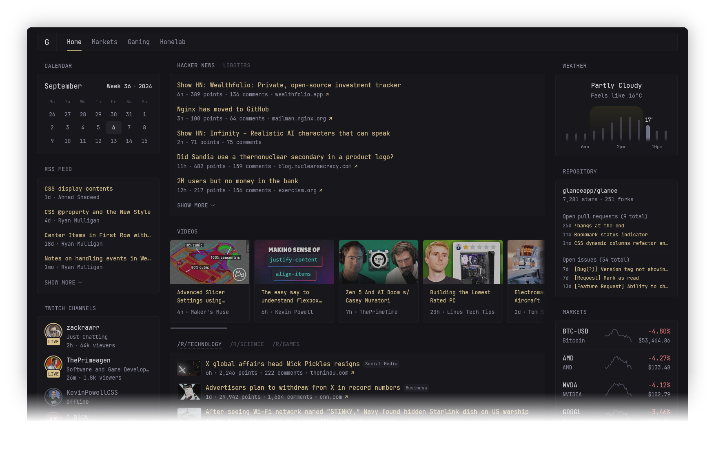
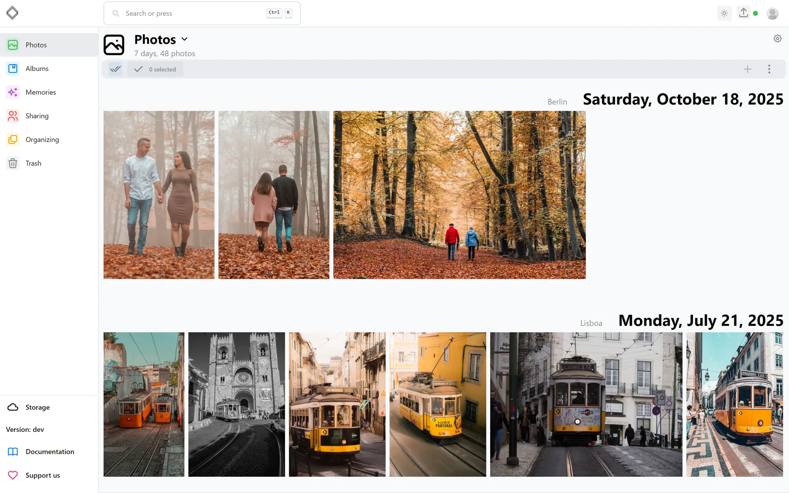

# Self-Hosting Weekly

## August 28, 2026 · Edition #1

The first edition was intentionally broad and ended up heavily weighted toward homelab dashboards, monitoring, networking, and infrastructure. That imbalance became useful feedback: future editions shifted toward productivity, utilities, and software that can replace paid SaaS.

> Archived from the original weekly ChatGPT report. The wording has been normalized for the Markdown archive while preserving the projects, recommendations, and week-specific context.

## Top picks

- **LAN Sheriff — strongest new network-visibility pick**
- **AMUD Dashboard — polished dashboard pick**
- **Filetree — most practical utility**
- **InSpectre — notable security/network tool**

---

## New & Interesting

### 1. LAN Sheriff

[Project link](https://github.com/search?q=%22LAN+Sheriff%22&type=repositories)

A new network-visibility tool aimed at making it easier to understand what devices are on a home network and what they are doing. It was one of the strongest early discoveries in the first edition, though it leaned more toward homelab operations than the later direction of this newsletter.

**Why it earned a spot:** It was polished enough to stand out among the new network utilities and gave a good snapshot of what the early report was surfacing.

### 2. InSpectre

[Project link](https://github.com/search?q=InSpectre+self-hosted&type=repositories)

A self-hosted network and security scanning project for inspecting devices and services on a local network. It fit well with a technically sophisticated home lab, but it also helped reveal that the first edition was too infrastructure-heavy.

**Why it earned a spot:** Useful security visibility with a practical home-network focus.

### 3. AMUD Dashboard

[Project link](https://github.com/search?q=%22AMUD+Dashboard%22&type=repositories)

A homelab dashboard intended to consolidate common service information into a single web interface. It offered the kind of polished overview that makes a collection of self-hosted services easier to use.

**Why it earned a spot:** One of the better-looking dashboard discoveries from the first week.

### 4. JagHelm

[Project link](https://github.com/search?q=JagHelm&type=repositories)

A dashboard and monitoring project for self-hosted environments. It combined service visibility with a compact control surface, making it useful for people running several small services.

**Why it earned a spot:** A solid example of the infrastructure-heavy direction of the first edition.

### 5. Labby

[Project link](https://github.com/search?q=Labby+self-hosted&type=repositories)

A lightweight dashboard for organizing and observing homelab services. Its appeal was simplicity rather than trying to become a full operations platform.

**Why it earned a spot:** Straightforward and practical for a small server collection.

### 6. MangoRack

[Project link](https://github.com/search?q=MangoRack&type=repositories)

A monitoring and logging project aimed at small self-hosted environments. It offered a more approachable alternative to assembling a large observability stack.

**Why it earned a spot:** It tried to solve a real operational problem without enterprise-scale complexity.

### 7. WatchDog

[Project link](https://github.com/search?q=WatchDog+self-hosted+uptime&type=repositories)

An agent-based uptime and service monitoring project. It focused on answering the basic question of whether services are healthy and reachable.

**Why it earned a spot:** Useful, but part of the cluster of monitoring tools that later prompted the newsletter's SaaS-replacement pivot.

### 8. SuperKuma

[Project link](https://github.com/search?q=SuperKuma&type=repositories)

A federated monitoring project inspired by the Uptime Kuma ecosystem. It was interesting for people operating multiple sites or servers that needed one place to see service health.

**Why it earned a spot:** A clever extension of a familiar self-hosted monitoring workflow.

### 9. AllisWell

[Project link](https://github.com/search?q=AllisWell+tasks+projects+notes&type=repositories)

A combined tasks, projects, and notes workspace. It looked like one of the first entries in the report that could replace everyday productivity SaaS rather than merely manage servers. Its PolyForm Noncommercial licensing made it source-available rather than fully FOSS.

**Why it earned a spot:** It pointed directly toward the productivity/SaaS-replacement focus adopted in later editions.

### 10. Hermes Notes

[Project link](https://github.com/search?q=%22Hermes+Notes%22&type=repositories)

A notes workspace that also included tasks, projects, people, and bookmarks. The scope made it an interesting all-in-one personal information hub.

**Why it earned a spot:** A practical productivity project rather than infrastructure for infrastructure's sake.

### 11. Planneer

[Project link](https://github.com/search?q=Planneer+self-hosted&type=repositories)

A lightweight tasks-and-notes application focused on planning daily work. It was young, but its narrower scope made it more approachable than a full project-management suite.

**Why it earned a spot:** Small, focused personal productivity tools were already emerging as the most useful finds.

### 12. Filetree

[Project link](https://github.com/search?q=Filetree+self-hosted+file+manager&type=repositories)

A lightweight web file manager intended for browsing and managing files on a self-hosted server. It was one of the strongest utilities in the first edition because it provided direct everyday value instead of just infrastructure telemetry.

**Why it earned a spot:** A useful NAS-friendly tool with an immediately understandable purpose.

### 13. ProxyOS

[Project link](https://github.com/search?q=ProxyOS+Caddy&type=repositories)

A Caddy-oriented reverse-proxy manager for people who wanted a UI over proxy configuration. It fit neatly into small homelabs that wanted easier HTTPS routing.

**Why it earned a spot:** Useful infrastructure, although later reports intentionally reduced this category.

### 14. Wiredoor

[Project link](https://github.com/search?q=Wiredoor+WireGuard+self-hosted&type=repositories)

A self-hosted ingress and WireGuard project for securely reaching internal services. It emphasized private connectivity instead of public exposure.

**Why it earned a spot:** Interesting for remote-access setups, especially where simple VPN-style access was preferable to opening ports.

### 15. Traefik Manager

[Project link](https://github.com/search?q=%22Traefik+Manager%22&type=repositories)

A management UI for Traefik-oriented deployments. It aimed to make reverse-proxy configuration more visible and approachable.

**Why it earned a spot:** Handy for people already committed to Traefik, but another sign the first report over-indexed on infrastructure.

### 16. Hostyt Proxy Gateway

[Project link](https://github.com/search?q=Hostyt+Proxy+Gateway&type=repositories)

A proxy gateway project focused on exposing self-hosted services through a managed front door. It competed in the same general space as several newer ingress products.

**Why it earned a spot:** A technically interesting project, though less aligned with the eventual productivity-first curation.

### 17. usulnet

[Project link](https://github.com/search?q=usulnet&type=repositories)

A broader infrastructure-control project for managing self-hosted resources. Its ambition was closer to a control plane than a single-purpose utility.

**Why it earned a spot:** Worth noting for advanced homelab users, but far beyond what most people need to replace SaaS.

### 18. Nestarr

[Project link](https://github.com/search?q=Nestarr+inventory&type=repositories)

A household inventory application for tracking possessions and where they are stored. It stood out because it solved a practical home-management problem rather than a server-management problem.

**Why it earned a spot:** One of the first clear examples of the kind of personal utility the later newsletter would emphasize.

### 19. Stash

[Project link](https://github.com/search?q=Stash+inventory+self-hosted&type=repositories)

Another inventory-oriented application for cataloging household items and storage locations. It competed with spreadsheets and small commercial home-inventory services.

**Why it earned a spot:** A useful self-hosted household utility with an obvious recurring-SaaS replacement angle.

### 20. Silo

[Project link](https://github.com/search?q=Silo+media+server+Jellyfin&type=repositories)

A media-server project with Jellyfin compatibility in mind. It explored a more modern media experience while remaining self-hostable.

**Why it earned a spot:** Media applications are one of the areas where self-hosting can directly replace recurring consumer subscriptions.

### 21. Lunarr

[Project link](https://github.com/search?q=Lunarr+media+server&type=repositories)

A newer media-server project focused on a polished personal streaming experience. It was still early, but interesting as an alternative to the established media stacks.

**Why it earned a spot:** A promising media project that broadened the first report beyond infrastructure.

### 22. Self Photos

[Project link](https://github.com/search?q=%22Self+Photos%22+self-hosted&type=repositories)

A photo organizer intended to keep a personal image library under the user's control. It addressed the same broad need as cloud photo services without requiring a third-party account.

**Why it earned a spot:** Photo management is a direct and valuable consumer SaaS replacement category.

### 23. Reframe

[Project link](https://github.com/search?q=Reframe+self-hosted+photos&type=repositories)

A photo-management project with an emphasis on organizing and browsing a personal collection. It was another early sign that the report could cover consumer utilities rather than only servers.

**Why it earned a spot:** Useful for people trying to own their photo library and its metadata.

### 24. BackupSheep

[Project link](https://github.com/search?q=BackupSheep&type=repositories)

A backup SaaS that was rewritten and released as self-hosted open-source software. It wrapped backup jobs in a friendlier interface rather than forcing users to maintain custom scripts.

**Why it earned a spot:** A textbook 'stop paying for a small SaaS and host the workflow yourself' example.

### 25. DBackup

[Project link](https://github.com/search?q=DBackup+self-hosted&type=repositories)

A database-backup application focused on automating routine database exports and retention. It simplified an important but repetitive maintenance job.

**Why it earned a spot:** A good example of infrastructure that directly reduces recurring operational effort.

---

## Notable Updates

### 26. LibrePhotos 1.1.0

[Project link](https://github.com/LibrePhotos/librephotos)

LibrePhotos shipped a notable 1.1.0 update, continuing its development as a self-hosted photo-management alternative. The project remained one of the more credible options for people who wanted cloud-style photo browsing while retaining control of their library.

**Why the update mattered:** The release showed continued momentum in a consumer-facing self-hosted category.

### 27. Cosmos Server 0.23.0

[Project link](https://github.com/azukaar/Cosmos-Server)

Cosmos Server released version 0.23.0 with improvements to its all-in-one self-hosting platform. It combined service management, reverse proxying, and authentication in one environment.

**Why the update mattered:** A meaningful update for users who preferred one integrated platform over assembling separate infrastructure components.

### 28. Glance 0.8.5

[Project link](https://github.com/glanceapp/glance)

Glance 0.8.5 continued refining one of the cleanest self-hosted start-page and information dashboards. Its mix of feeds, service status, bookmarks, and external information made it useful beyond pure homelab monitoring.

**Why the update mattered:** Glance remained one of the rare dashboard projects that could double as an everyday personal information surface.

---

## Curation notes

This edition is preserved largely as a baseline. It explains why the newsletter changed direction immediately afterward: there was simply too much homelab infrastructure and not enough software that made everyday life easier.