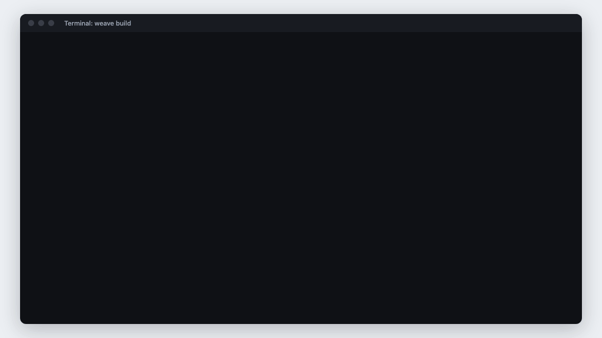
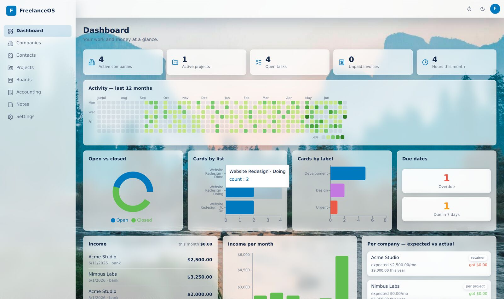

# Self-Hosting Weekly

## September 4, 2026 · Edition #2

This edition marked the deliberate pivot away from homelab plumbing and toward productivity, utilities, and self-hosted SaaS replacements. The result was a much stronger mix of everyday applications that could actually save subscription fees or simplify personal workflows.

> Archived from the original weekly ChatGPT report. The wording has been normalized for the Markdown archive while preserving the projects, recommendations, and week-specific context.

## Top picks

- **Weave — lightweight Airtable/Notion-style workspace**
- **Kintara — NAS-friendly document library**
- **Solova — broad small-business SaaS replacement**

---

## New & Interesting

### 1. Weave ★ Editor's Pick

[Project link](https://github.com/grunion-ai/weave)

A lightweight workspace combining linked tables, relationships, Markdown documents, and structured information. It could run from one Node process backed by SQLite, although the early version still lacked robust per-user authentication.

**Why it earned a spot:** It offered an unusually compact Airtable/Fibery/Notion-style experience and fit the new SaaS-replacement focus perfectly.

### 2. Solova ★ Excellent SaaS-Replacement Idea

[Project link](https://github.com/morpheusadam/Solova)

An all-in-one small-business workspace covering Kanban, CRM, clients, contracts, time tracking, invoicing, expenses, payments, and double-entry accounting. Docker Compose and PostgreSQL made it more substantial than the tiniest apps, but the breadth was impressive.

**Why it earned a spot:** It had the potential to replace several separate subscriptions such as HoneyBook, Bonsai, Trello, and invoicing software.

### 3. Kintara ★ NAS-Friendly Pick

[Project link](https://github.com/pinkpixel-dev/kintara)

A document library that can point at existing folders of PDFs, Markdown, and text, then add metadata, thumbnails, search, reading progress, annotations, collections, and sharing. A Rust backend serves a React interface, making it a natural fit for NAS storage.

**Why it earned a spot:** It respected existing files instead of forcing a migration into a proprietary database or storage layout.

### 4. Granit

[Project link](https://github.com/Artaeon/granit)

A Markdown-based personal knowledge and work system combining notes, tasks, calendar, routines, finance, and habits. It worked with ordinary files that could also be edited from Obsidian, Logseq, Vim, or VS Code.

**Why it earned a spot:** A single Go binary plus portable Markdown made it especially attractive for terminal-oriented workflows.

### 5. OpenSurvey

[Project link](https://github.com/mohitbadwal/opensurvey)

A young survey and form builder with conditional logic, NPS, analytics, contacts, segmentation, teams, RBAC, webhooks, and white-labeling. It used Django and PostgreSQL.

**Why it earned a spot:** A promising open alternative to Typeform and Formbricks, though still early enough to test cautiously.

### 6. Sharedrive

[Project link](https://github.com/Kronborgs/sharedrive)

A self-hosted file workspace with resumable uploads, WebDAV, sharing, collaborative docs, notes, checklists, TOTP, backups, and administration. It was packaged as a single Docker container.

**Why it earned a spot:** A broad Dropbox/Drive-style replacement with a simpler deployment story than many collaboration suites.

### 7. DOMUS

[Project link](https://github.com/umbi97/domus-budget)

An offline-first household budget application with a local replica on each device, SQLite storage, and family access. It focused on practical shared money management rather than investment tracking.

**Why it earned a spot:** A good example of personal finance software that can work without sending household data to a SaaS provider.

### 8. OpenCoffer

[Project link](https://github.com/osirishorus/opencoffer)

A self-hosted finance dashboard with SimpleFIN sync, net worth, cash flow, spending, subscriptions, investments, budgets, and alerts. Connected accounts were read-only, reducing the risk of accidental financial actions.

**Why it earned a spot:** It targeted the Monarch-style personal finance dashboard category while letting users retain control of their data.

### 9. Finlynq

[Project link](https://github.com/finlynq/finlynq)

A young budgeting and transaction-management project with an API, CSV import, Docker support, and optional MCP integration. It was promising but still early.

**Why it earned a spot:** Useful to watch as a smaller finance platform that could grow without requiring a commercial cloud account.

### 10. Open Finance

[Project link](https://github.com/DeseretSaint/open-finance)

A local-first finance application using SQLite with optional Plaid support. It tracked bills, debt, goals, projections, and encrypted financial data across desktop, server, and Android environments.

**Why it earned a spot:** The local database and optional connectivity gave it a strong data-ownership story.

### 11. Balance Budget

[Project link](https://github.com/balance-budget/balance-budget)

A budgeting system built around a real double-entry ledger, statement inbox, and reporting. It was aimed at users who wanted accounting correctness rather than only envelope-style planning.

**Why it earned a spot:** A more rigorous option for people who outgrow simple expense trackers.

### 12. SubTrackr

[Project link](https://github.com/bscott/subtrackr)

A subscription tracker written with Go and HTMX, including renewal calendars, notifications, and CSV support. Its scope was deliberately narrow.

**Why it earned a spot:** Recurring-subscription visibility is an excellent small self-hosted utility because it can directly help eliminate other recurring charges.

### 13. Wallos

[Project link](https://github.com/ellite/Wallos)

An established subscription manager with categories, budgets, multi-currency support, statistics, notifications, and OIDC. It was considerably more mature than most newcomers in the same category.

**Why it earned a spot:** A strong production choice for tracking recurring expenses without bank aggregation.

### 14. Zettelgarden

[Project link](https://github.com/Zettelgarden/Zettelgarden)

A local-first knowledge system combining atomic notes, backlinks, tasks, RSS, and a knowledge graph. Data lived in SQLite and could be exported to JSON, Markdown, or CSV.

**Why it earned a spot:** A flexible personal knowledge base that retained useful escape hatches for the user's data.

### 15. Stellar Planner

[Project link](https://github.com/prabhask5/stellar)

A goals, tasks, routines, projects, and Pomodoro planner with an offline-first PWA design. It used IndexedDB locally with optional self-controlled Supabase synchronization.

**Why it earned a spot:** A useful alternative to combining several focus and planning subscriptions.

### 16. Shiori

[Project link](https://github.com/go-shiori/shiori)

A mature Go bookmark manager that can archive web pages for offline reading and offers both web and CLI interfaces. It had roughly 11K stars at the time.

**Why it earned a spot:** A lightweight, dependable alternative to Pocket and basic bookmark SaaS.

### 17. Paperwise

[Project link](https://paperwise.dev/)

A document organizer for PDFs, scans, and statements with local OCR, tagging, search, and citation-backed Q&A. The project emphasized no telemetry and local processing.

**Why it earned a spot:** A privacy-minded document workflow for people who wanted search and organization without uploading paperwork to a cloud service.

### 18. DayOtter

[Project link](https://github.com/Dayotter/dayotter)

A scheduling platform with event pages, calendar sync, group polls, recurring meetings, payments, prepaid packages, team booking, and routing. It was AGPLv3.

**Why it earned a spot:** A serious attempt to replace Calendly-style scheduling and several adjacent booking tools.

### 19. z8run

[Project link](https://github.com/z8run/z8run)

A young Rust workflow engine with a React visual editor, one binary plus SQLite, and WASM plugins. It sat somewhere between cron, Node-RED, and n8n.

**Why it earned a spot:** A compelling lightweight automation architecture worth watching.

### 20. OpenScreenShot

[Project link](https://openscreenshot.app/)

A local-first screenshot and recording utility with full-page captures, annotations, blur/redaction, tab recording, and PDF/image export. It required no account, upload, or telemetry.

**Why it earned a spot:** A clean replacement for several small screenshot and web-capture subscriptions.

---

## Notable Updates

### 21. Vikunja 2.6.0

[Project link](https://vikunja.io/changelog/vikunja-2.6.0-was-released/)

The August 31 release included 18 security fixes, five rated high, plus Planka migration, attachment previews, CalDAV improvements, imports, and query refinements.

**Why the update mattered:** The security work alone made the release worth highlighting for existing users.

### 22. Paperless-ngx 3.1.0

[Project link](https://github.com/paperless-ngx/paperless-ngx)

Paperless-ngx 3.1.0 landed August 27 with document versioning and workflow improvements. The project remained one of the strongest self-hosted document-management systems.

**Why the update mattered:** It continued to mature in exactly the kind of household/document SaaS-replacement category this report wanted to emphasize.

### 23. Documenso 2.17

[Project link](https://documenso.com/changelog)

The August 19–20 release added API token management, preferences reset, filtering, and bulk download improvements.

**Why the update mattered:** A useful update to one of the leading open-source DocuSign alternatives.

### 24. Actual Budget 26.8

[Project link](https://actualbudget.org/blog/)

The August release stabilized Age of Money and payee locations, improved onboarding and mobile bank sync/reconciliation, and added report CSV export.

**Why the update mattered:** Actual continued proving that a polished YNAB-style workflow does not require a recurring subscription.

### 25. SiYuan 3.8.2

[Project link](https://github.com/siyuan-note/siyuan)

SiYuan shipped 3.8.2 around August 30 and had roughly 46K stars. It remained one of the most active self-hosted knowledge-workspace projects.

**Why the update mattered:** Large community traction and frequent releases made it a lower-risk choice than many brand-new note apps.

### 26. Karakeep 0.33.x

[Project link](https://github.com/karakeep-app/karakeep/releases)

The 0.33 series added semantic search, offline mobile reading, and security fixes. It continued evolving from a bookmark manager into a broader read-it-later/archive tool.

**Why the update mattered:** A meaningful update for anyone looking to replace Pocket or Raindrop.

### 27. Stirling PDF 2.14.x

[Project link](https://github.com/Stirling-Tools/Stirling-PDF)

Stirling PDF continued expanding its already huge set of PDF tools and had roughly 89K stars. It remained one of the easiest ways to replace a collection of online PDF utilities.

**Why the update mattered:** The combination of maturity and breadth made it an obvious utility recommendation.

---

## Curation notes

The target mix was now explicit: roughly 70–80% productivity/utilities/SaaS replacement, with infrastructure kept to a minority unless a project was unusually compelling.