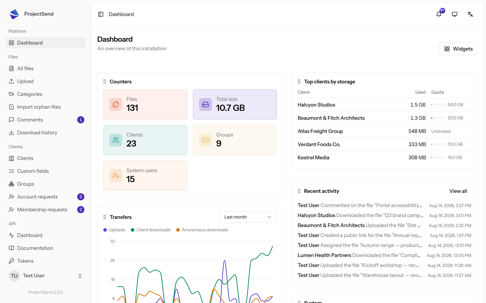

# Self-Hosting Weekly

## September 18, 2026 · Edition #4

This edition leaned heavily into direct SaaS replacement: social scheduling, invoicing, client file delivery, dictation, project management, and mature self-hosted business tools. Infrastructure was included only where it clearly displaced paid developer services.

> Archived from the original weekly ChatGPT report. The wording has been normalized for the Markdown archive while preserving the projects, recommendations, and week-specific context.

## Top picks

- **OpenPost — social scheduling**
- **Amical — local dictation**
- **GetPaid / Invoice Builder — invoicing**
- **Plik — mature file transfer**

---

## New & Interesting

### 1. OpenPost ★ Editor's Pick

[Project link](https://openpo.st/)

OpenPost was a self-hosted social-media management suite for drafting, reviewing, scheduling, and tracking posts across Bluesky, LinkedIn, Mastodon, Threads, and X. It included a media library, image/video editing, analytics, and collaboration, was AGPL-3.0, and shipped v4.30.3 on September 12.

**Why it earned a spot:** It directly replaced a mundane but often expensive SaaS category such as Buffer or Hootsuite.

### 2. Ubimate ★ One to Watch

[Project link](https://www.ubimate.com/)

Ubimate combined rich-text outlining, relational databases, tables, charts, and diagrams in a local-first workspace. The desktop app worked offline without an account, while its open-source sync/collaboration backend could be self-hosted with Docker Compose.

**Why it earned a spot:** The 'free local app + open server if I want sync' model was excellent.

### 3. GetPaid ★ Tiny SaaS-Replacement Pick

[Project link](https://github.com/maksim-pokhiliy/getpaid)

GetPaid focused specifically on invoicing rather than becoming a full accounting package. It handled line items, tax, discounts, PDF generation, view tracking, and a simple revenue/outstanding-payment dashboard using Next.js, PostgreSQL, and Prisma.

**Why it earned a spot:** Not everyone who needs to send an invoice wants to install an ERP.

### 4. Invoice Builder

[Project link](https://github.com/piratuks/invoice-builder)

Invoice Builder was a more capable offline-first invoicing and quotation tool with desktop and Docker deployments, SQLite/PostgreSQL, a drag-and-drop PDF layout designer, receipt printing, multiple languages, and European electronic-invoice formats.

**Why it earned a spot:** The visual invoice designer was unusually sophisticated for a FOSS invoicing project.

### 5. InsulaCRM

[Project link](https://insulacrm.com/)

InsulaCRM was a real-estate-specific CRM with leads, properties, Kanban deal pipelines, buyer matching, document uploads, follow-up sequences, REST APIs, and webhooks. It used Laravel/Livewire/MySQL, supported Docker, and was MIT licensed without subscription tiers.

**Why it earned a spot:** Vertical open-source SaaS replacements are rarer and often more valuable than generic CRMs.

### 6. TropaTT

[Project link](https://github.com/Anton-Barinov/TropaTT)

TropaTT combined CRM, hierarchical tasks, projects, Kanban, Gantt, calendar, wiki, chat, client portal, billing, and analytics. Its operational footprint was intentionally old-school: PHP 8.1+ and MySQL/MariaDB with no runtime Composer/npm requirement or permanent daemon.

**Why it earned a spot:** Shared-hosting deployability is a real advantage when the alternative needs a complex container stack.

### 7. Plik

[Project link](https://github.com/root-gg/plik)

Plik was an established WeTransfer replacement with a Vue 3 web UI, CLI, expiring uploads, one-shot downloads, stream mode, Age-based end-to-end encryption, OIDC, and local/S3/Swift/GCS storage. SQLite worked for small installs, with PostgreSQL and MySQL as options.

**Why it earned a spot:** It was the mature file-transfer choice when operational history mattered more than novelty.

### 8. Droplink

[Project link](https://github.com/bensblueprints/droplink-mvp)

Droplink was a new WeTransfer-style tool using one Express process for the API and React SPA with SQLite metadata. Uploads were chunked and resumable, with expiry, passwords, download limits, and ZIP-all support.

**Why it earned a spot:** Thoughtful handling of interrupted uploads and integrity checks suggested good engineering discipline.

### 9. ProjectSend 2 ★ Mature Choice

[Project link](https://www.projectsend.org/)

ProjectSend was a client-facing file portal rather than simple temporary transfer. It assigned specific files to specific clients, supported professional branding, and had a long operating history; the 2.x generation modernized the architecture and Docker story.

**Why it earned a spot:** Longevity is especially valuable for software used to deliver files to customers.

### 10. Amical ★ Personal Utility Pick

[Project link](https://github.com/amicalhq/amical)

Amical was a local-first system-wide dictation app for macOS and Windows using Whisper/local models, adapting formatting to the active application. It was MIT licensed, around 1.5K stars, and had v1.11.3 current on September 17.

**Why it earned a spot:** Good dictation is valuable enough that a perpetual subscription just for speech-to-text is hard to justify.

### 11. BookOrbit ★ Media/Productivity Crossover

[Project link](https://github.com/BookOrbit/bookorbit)

BookOrbit managed ebooks, PDFs, audiobooks, and comics with a web reader and three-way Kobo/KOReader sync. It also integrated reading state with Hardcover, Readwise, and StoryGraph and included statistics, goals, achievements, and multiple libraries.

**Why it earned a spot:** Rapid growth to roughly 4.2K stars in its founding year suggested genuine traction.

### 12. Cal.diy ★ Interesting Fork

[Project link](https://github.com/calcom/cal.com)

Cal.diy was a community scheduling platform derived from Cal.com with commercial/enterprise code removed, leaving an MIT-licensed Next.js/tRPC/Prisma/PostgreSQL stack. The project represented the heavyweight end of self-hosted scheduling.

**Why it earned a spot:** It gave users a more permissively licensed path for Calendly-style scheduling.

### 13. listmonk

[Project link](https://listmonk.app/)

listmonk was resurfaced as the mature newsletter half of a possible self-owned marketing stack alongside OpenPost. One Go binary plus PostgreSQL covered mailing lists, segmentation, templates, and campaign analytics.

**Why it earned a spot:** It remained the benchmark for focused newsletter software without per-subscriber pricing.

### 14. wger

[Project link](https://wger.de/)

wger covered workouts, routines, nutrition, and progress tracking across web, Android, and iOS. It was AGPL, around 6.9K stars, integrated with Open Food Facts, and released 2.7 on September 3.

**Why it earned a spot:** Personal SaaS replacement should include fitness and nutrition, not just notes and tasks.

### 15. diagrams.net

[Project link](https://www.diagrams.net/)

diagrams.net handled flowcharts, architecture diagrams, UML, network diagrams, and whiteboards and could be fully self-hosted with an official Docker deployment. Version 31.4.5 had been released September 8.

**Why it earned a spot:** A mature, boring, capable alternative to Visio and Lucidchart is exactly what self-hosting should provide.

### 16. Activepieces

[Project link](https://www.activepieces.com/)

Activepieces was a visual no-code automation platform with more than 200 integrations and a self-hostable MIT-licensed core. It had roughly 24K stars and a September 9 0.88.4-hotfix.3 line.

**Why it earned a spot:** It was becoming a serious Zapier/Make alternative rather than a curiosity.

### 17. Standard Notes

[Project link](https://standardnotes.com/)

Standard Notes combined end-to-end encrypted notes/files with web, desktop, and mobile clients, and both the client and sync infrastructure could be self-hosted. Desktop 3.202.0 landed September 17.

**Why it earned a spot:** Maturity and encryption made it a safer long-term choice than many flashy new note apps.

### 18. SimpleX

[Project link](https://simplex.chat/)

SimpleX was a private messaging system notable for avoiding global user identifiers. Android/iOS, desktop, and terminal clients could use infrastructure you operated yourself.

**Why it earned a spot:** It offered a different privacy model where minimizing metadata mattered as much as owning the server.

---

## Notable Updates

### 19. Vaultwarden 1.37.3

[Project link](https://github.com/dani-garcia/vaultwarden)

Vaultwarden released 1.37.3 on September 13 and remained one of the best small-server password backends, with roughly 67K stars and an efficient Rust implementation.

**Why the update mattered:** Password infrastructure benefits from active maintenance and a very large user base.

### 20. Bitwarden Self-Host 2026.9.0

[Project link](https://github.com/bitwarden/self-host)

Bitwarden's official self-host package shipped 2026.9.0 on September 17, updating Core and Web to the September release.

**Why the update mattered:** It remained the upstream/full-stack alternative when official-server compatibility mattered more than minimal resource use.

### 21. OpenProject 17.8

[Project link](https://www.openproject.org/)

OpenProject remained the mature heavyweight for project/portfolio management, Agile, Gantt, time tracking, wikis, and meetings. Version 17.8.0 was current in September with strong ongoing activity.

**Why the update mattered:** It was the safer mature choice compared with brand-new Linear-style clones.

### 22. Wekan 11.72

[Project link](https://wekan.github.io/)

Wekan 11.72 shipped September 11 and continued providing a straightforward MIT-licensed self-hosted Kanban board with roughly 21K stars.

**Why the update mattered:** It proved that moving cards between columns does not require an all-in-one company operating system.

### 23. SiYuan 3.8.3

[Project link](https://b3log.org/siyuan/)

SiYuan moved from 3.8.2 to 3.8.3 on September 7 and remained extremely active at roughly 46K stars.

**Why the update mattered:** The rapid cadence reinforced its project-health signal.

### 24. ProjectSend 2.4.1

[Project link](https://www.projectsend.org/)

ProjectSend's 2.4.1 release continued the modernization of a project that had existed since 2011, with Docker as the recommended deployment and client-specific file access intact.

**Why the update mattered:** A proven utility receiving a major modernization was more interesting than a routine patch.

### 25. Tindra 1.0

[Project link](https://www.tindra.sh/)

Tindra reached 1.0.0 on September 11, combining error tracking, structured logs, traces, profiles, uptime, and cron monitoring in one application plus PostgreSQL.

**Why the update mattered:** It earned an infrastructure exception because it could replace several expensive developer SaaS subscriptions.

---

## Curation notes

The strongest theme was that small recurring SaaS charges—social scheduling, invoicing, time tracking, file delivery, dictation—are increasingly replaceable with polished open-source tools.