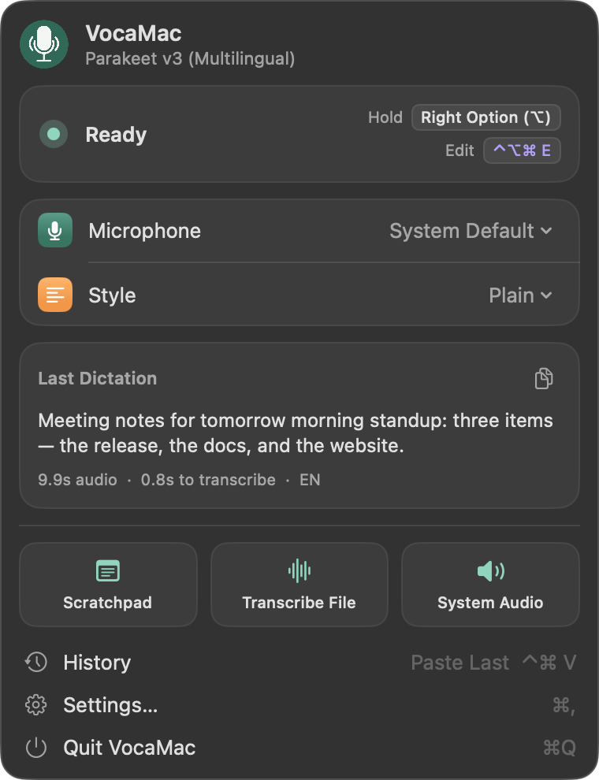
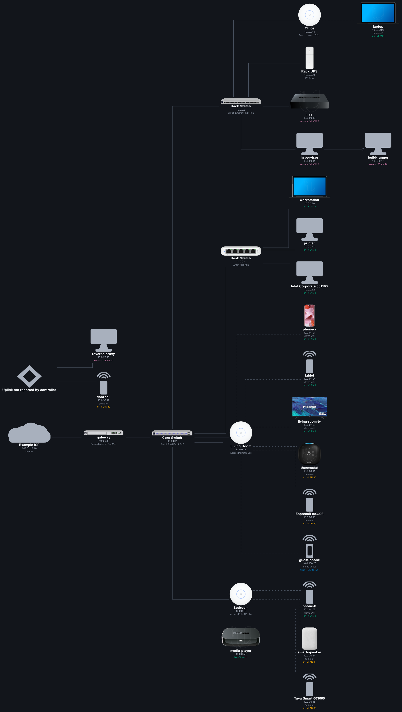

# Self-Hosting Weekly

## September 25, 2026 · Edition #5

This week was unusually strong for small, focused software that replaces things people routinely pay for: weekly planning, read-it-later, ebook libraries, dictation, native file access, invoicing, automation, and household utilities.

> Archived from the original weekly ChatGPT report. The wording has been normalized for the Markdown archive while preserving the projects, recommendations, and week-specific context.

## Top picks

- **Will Be Done — visual weekly planner**
- **Indelible — lightweight read-it-later**
- **VocaHQ — local dictation ecosystem**
- **Shelfwarden — NAS-friendly ebook library**
- **unifi-map — useful infra exception**

---

## New & Interesting

### 1. Will Be Done ★ Editor's Pick

[Project link](https://github.com/will-be-done/will-be-done)

Will Be Done centered planning around a visual seven-day timeline instead of copying Todoist. Users could collect tasks, drag them onto realistic days, and keep immediate priorities in a persistent Stash; it worked offline, synchronized later, used SQLite by default, exposed an HTTP API, and could self-host with one `docker run`.

**Why it earned a spot:** Local-first operation, SQLite, one container, and a genuinely different planning model made it the standout.

### 2. Indelible ★ Read-It-Later Pick

[Project link](https://github.com/useindelible/indelible)

Indelible was a lightweight read-it-later service capable of saving articles, PDFs, EPUBs, and YouTube videos. It offered browser extensions, Android support, tags, collections, highlights, saved filters, webhooks, Obsidian synchronization, Notion export, and optional local-model features; the developer targeted sub-50 MB idle memory.

**Why it earned a spot:** The Obsidian integration and tiny footprint made it more interesting than another generic bookmark manager.

### 3. Shelfwarden ★ NAS-Friendly Pick

[Project link](https://github.com/gordon-matt/Shelfwarden)

Shelfwarden indexed existing folders of EPUBs and PDFs without forcing a new directory layout. It understood Calibre metadata, rescanned only changed files, and added browser readers, per-user progress, bookmarks, notes, authors, series, collections, and reading lists.

**Why it earned a spot:** Pointing it at books already on a NAS was exactly the right philosophy.

### 4. VocaHQ ★ Utility Pick

[Project link](https://github.com/VocaHQ/VocaMac)

VocaHQ was becoming a cross-platform offline dictation ecosystem with VocaMac, VocaLinux, and VocaWin plus a self-hosted VocaGateway for offloading transcription to a stronger machine. Once models were downloaded, processing could remain local with no account, telemetry, or subscription.

**Why it earned a spot:** A self-hosted transcription gateway could let lightweight devices share a stronger local model while keeping audio private.

### 5. NextExplorer + iOS

[Project link](https://github.com/nxzai/NextExplorer)

NextExplorer offered a polished Docker-first file manager with OIDC, groups, previews, thumbnails, text/code editing, ripgrep full-text search, share links, and modern views. A new native iPhone/iPad companion added offline caching, VLCKit playback, PDF/ZIP viewing, syntax-highlighted editing, and multilingual support.

**Why it earned a spot:** Good native mobile clients are one of the biggest missing pieces in self-hosting, so this stood out.

### 6. Syllogi

[Project link](https://github.com/search?q=Syllogi+self-hosted+music&type=repositories)

Syllogi kept locally owned music synchronized with playlists followed on streaming services. It handled scheduled playlist sync, reports, downloads via yt-dlp or slskd, recommendations, charts, retagging, and library cleanup.

**Why it earned a spot:** It automated exactly the messy glue work that otherwise turns into a pile of scripts.

### 7. mc-gamertime

[Project link](https://github.com/Strandgaard96/mc-gamertime)

mc-gamertime tracked board-game collections and sessions with BoardGameGeek metadata, player profiles, head-to-head records, achievements, and leaderboards. It used React and FastAPI with Docker Compose.

**Why it earned a spot:** A fun example of self-hosting replacing a niche paid mobile utility rather than another enterprise dashboard.

### 8. Stow

[Project link](https://github.com/jonhnet/stow)

Stow was a very new lightweight notes app with draggable cards, Markdown bodies, checklists, images, links, colors, labels, full-text search, offline work, sync, and Android PWA support. It was AGPL-3.0 and still too young for important long-term notes.

**Why it earned a spot:** Google Keep is surprisingly underserved by self-hosted software; not everyone needs a Notion clone.

### 9. InvoiceShelf ★ Mature SaaS Replacement

[Project link](https://invoiceshelf.com/)

InvoiceShelf handled invoices, estimates, recurring billing, expenses, payments, multi-company operation, customer portals, taxes, reports, and multiple currencies with no seat limits or subscription. Stable 2.4.5 shipped September 23 while the 3.0 alpha series was actively moving.

**Why it earned a spot:** This was a real production-capable FreshBooks/Invoice Ninja alternative rather than a weekend experiment.

### 10. anarlog

[Project link](https://github.com/fastrepl/anarlog)

anarlog recorded device audio rather than sending a bot into calls, keeping capture, transcription, notes, and summaries separate. Sessions and transcripts lived in SQLite, and on supported systems transcription could happen entirely on-device.

**Why it earned a spot:** A local-first alternative to Granola, Otter, or Fireflies was exactly the sort of AI-adjacent tool worth including.

### 11. Rallly

[Project link](https://rallly.co/)

Rallly was a mature AGPL group-scheduling tool built around availability polls rather than forcing everyone into one calendar provider. It had roughly 5.3K stars and released 4.15.0 on September 9.

**Why it earned a spot:** It solved one mundane problem extremely well and could replace Doodle without bringing along a huge calendar platform.

### 12. WBO

[Project link](https://wbo.ophir.dev/)

WBO was a mature realtime collaborative whiteboard with Docker support and roughly 2.7K stars. Version 2.17.1 shipped September 12.

**Why it earned a spot:** A focused, established alternative to simple Miro/FigJam use is more valuable than another sprawling collaboration suite.

### 13. Dagu ★ Automation Pick

[Project link](https://github.com/dagu-org/dagu)

Dagu wrapped existing scripts, commands, SSH operations, Docker jobs, and FFmpeg tasks in declarative YAML with dependencies, retries, schedules, logs, and a web UI. It ran from one Go binary with no external database or message broker.

**Why it earned a spot:** This was exactly the lightweight layer that can replace increasingly elaborate cron setups on a small server.

### 14. Epure

[Project link](https://github.com/epure-sh/epure)

Epure deliberately implemented 'Sentry minus everything except errors.' Existing Sentry SDKs could be repointed by changing the DSN, while grouped issues, breadcrumbs, releases, alerts, and source maps remained available from a Compose stack of Epure plus PostgreSQL.

**Why it earned a spot:** Scope reduction is a feature for small projects that do not need an observability platform.

### 15. Pingularity

[Project link](https://pingularity.dev/)

Pingularity scheduled Ookla and iperf3 tests and tracked download/upload speeds, ping, jitter, bufferbloat, DNS results, and outages over time. It exported to Prometheus/Grafana, supported alerts and backups, and ran as a single binary with no telemetry.

**Why it earned a spot:** Historical ISP evidence is much more useful than a one-off speed test when problems are intermittent.

### 16. unifi-map ★ Particularly Relevant Utility

[Project link](https://github.com/gitkodak/unifi-map)

unifi-map connected to a UniFi controller and exported discovered topology as SVG, PDF, PNG, HTML, DOT, Mermaid, JSON, or editable draw.io diagrams. It was a CLI rather than an always-running service.

**Why it earned a spot:** Automatically generating an editable network diagram is unusually useful and saves real maintenance work.

### 17. RustDesk

[Project link](https://rustdesk.com/)

RustDesk remained the most convincing self-owned TeamViewer/AnyDesk alternative, with Windows, macOS, Linux, Android, and iOS clients connecting through user-operated rendezvous/relay infrastructure. It had grown to roughly 124K stars.

**Why it earned a spot:** This is exactly the kind of utility subscription mature FOSS can simply eliminate.

### 18. Kanboard

[Project link](https://kanboard.org/)

Kanboard was worth rediscovering as a deliberately focused Kanban application rather than a company operating system. It had existed since 2014, had nearly 10K stars, remained MIT licensed, and released 1.2.54 at the end of August.

**Why it earned a spot:** Old, boring, maintained task software is often precisely what you want.

### 19. Firefly III

[Project link](https://www.firefly-iii.org/)

Firefly III continued as one of the heavyweight self-hosted personal-finance choices, covering accounts, transactions, budgets, categories, bills, and reporting. Version 6.7.3 arrived September 18.

**Why it earned a spot:** It remained a strong choice for account/transaction management rather than envelope budgeting.

### 20. Memos

[Project link](https://usememos.com/)

Memos occupied a deliberately small niche: a private Markdown timeline for quick thoughts, daily notes, links, work logs, and snippets, with tags, pins, search, and selective publishing. It had grown to more than 63K stars.

**Why it earned a spot:** Sometimes the most useful productivity tool is the one with the least structure.

---

## Notable Updates

### 21. Actual Budget 26.9.0

[Project link](https://actualbudget.org/blog/release-26.9.0/)

Actual 26.9.0 added customizable transaction-table columns, improved onboarding, easier future-transaction scheduling, and an experimental Monte Carlo retirement report.

**Why the update mattered:** Actual continued evolving beyond an open-source YNAB clone into a genuinely excellent finance application.

### 22. Paperless-ngx 3.2.1

[Project link](https://docs.paperless-ngx.com/)

Paperless-ngx 3.2.1 shipped September 20 with mail-fetch locking improvements, OCR text-layer output fixes, and automatic rebuilding of missing Tantivy search indexes.

**Why the update mattered:** For a serious household document archive, Paperless-ngx remained the mature default.

### 23. Nextcloud 35

[Project link](https://nextcloud.com/install/)

Nextcloud 35.0.0 landed September 16 with a new major supported branch and a refreshed Android 35 client including sharing, faster file lists, tags, auto-upload, E2EE, and media-player improvements.

**Why the update mattered:** A full major release mattered for anyone using Nextcloud as a broad Google Drive/Workspace replacement.

### 24. OpenPost 6.0.2 ★ Rapid Growth

[Project link](https://openpo.st/)

OpenPost jumped from roughly 187 stars to about 605 in around a week and shipped 6.0.2 on September 23. Its social scheduling across Bluesky, LinkedIn, Mastodon, Threads, and X remained the core value.

**Why the update mattered:** Tripling community traction in a week was precisely the kind of signal worth repeating.

### 25. InvoiceShelf 3.0 Preview

[Project link](https://invoiceshelf.com/download)

Alongside stable 2.4.5, InvoiceShelf was publishing the 3.0 alpha series rapidly, reaching alpha.7 on September 24.

**Why the update mattered:** The cadence showed substantial active work behind the next major generation, even though production users should stay on 2.x.

### 26. NextExplorer native iOS client

[Project link](https://github.com/nxzai/NextExplorer)

The native iPhone/iPad beta supported offline caching and sync, native previews, media playback, code editing, search, and link sharing while talking only to the configured self-hosted server.

**Why the update mattered:** Mobile UX is often the difference between a technically good self-hosted file server and something that truly replaces Dropbox.

### 27. RustDesk 1.4.9

[Project link](https://rustdesk.com/)

RustDesk remained highly active with 1.4.9 current and its repository updated September 24. At roughly 124K stars it had moved firmly into mainstream open-source infrastructure.

**Why the update mattered:** Anyone who had not revisited it in years should reassess it at its current maturity level.

---

## Curation notes

The most appealing architecture pattern this week was again small and durable: SQLite, single binaries, plain files, and optional standards-based sync instead of cloud lock-in.