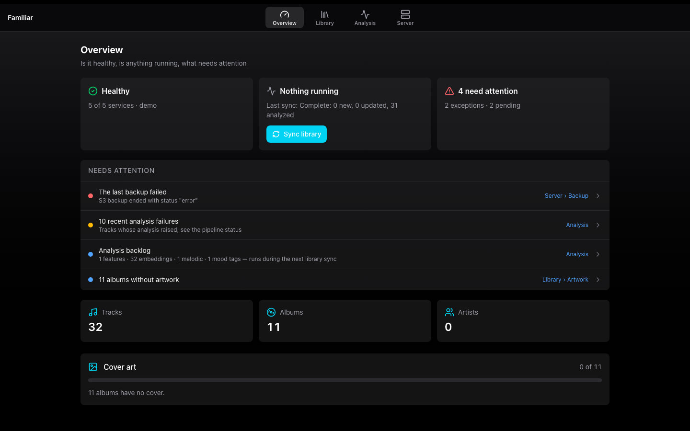
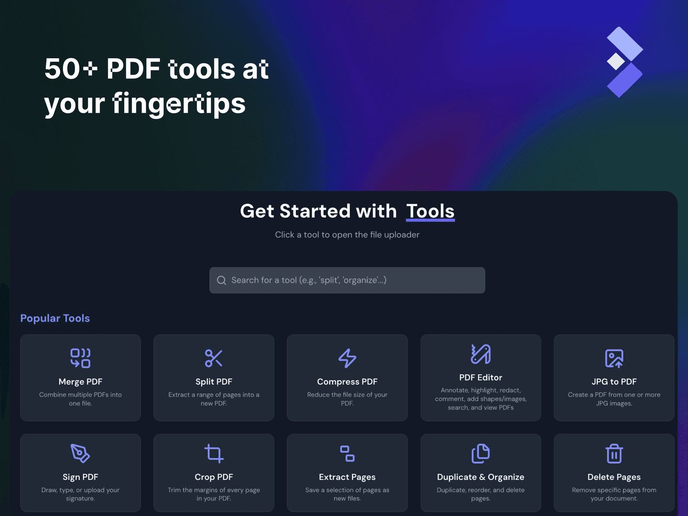

# Self-Hosting Weekly

## October 9, 2026 · Edition #7

This edition produced a particularly good mix of lightweight SaaS replacements: music, recipes, knowledge management, forms, PDF tools, signing, analytics, time tracking, CRM, newsletters, scheduling, and a small amount of infrastructure that directly replaced paid services.

> Archived from the original weekly ChatGPT report. The wording has been normalized for the Markdown archive while preserving the projects, recommendations, and week-specific context.

## Top picks

- **Familiar — Synology-friendly music server**
- **SilverBullet — programmable Markdown workspace**
- **Cooklang — plain-text recipe system**
- **BentoPDF — browser-side PDF toolkit**
- **Rybbit — privacy-focused analytics**

---

## New & Interesting

### 1. Familiar ★ Editor's Pick

[Project link](https://github.com/seethroughlab/familiar)

Familiar was a self-hosted music server that went beyond library browsing by analyzing the actual sound of tracks to generate recommendations and playlists. It provided Mac and iPhone clients, offline downloads, CarPlay support, a management UI, explicit Synology Container Manager instructions, and a low-memory configuration; v0.2.0-beta18 shipped October 4.

**Why it earned a spot:** Detailed Synology guidance, Apple clients, and a thoughtful deployment story made it one of the week's best fits for a practical home server.

### 2. Immerle ★ New Project

[Project link](https://github.com/immerle/immerle)

Immerle took the opposite architectural approach: a single Go binary with an embedded UI and SQLite database. It supported Subsonic clients, desktop and Android apps, internet radio, podcasts, Spotify playlist imports, shared listening sessions, and discovery through free-music catalogs, with AMD64/ARM64 Docker images.

**Why it earned a spot:** The architecture was attractive, but with only a handful of stars it was clearly an experiment rather than a production recommendation.

### 3. Cooklang ★ Productivity Pick

[Project link](https://github.com/cooklang/cookcli)

Cooklang stored recipes as human-readable text files instead of locking them inside an application database. Its Rust-based `cookcli` also included a web server for browsing recipes, scaling ingredients, shopping lists, and pantry management.

**Why it earned a spot:** Plain-text recipes editable in Git or any text editor were a great example of separating user data from the app used to manage it.

### 4. SilverBullet ★ Editor's Pick

[Project link](https://github.com/silverbulletmd/silverbullet)

SilverBullet was a browser-based Markdown knowledge system built around extensibility and local ownership. Its Lua-based automation, queries, templates, Git-friendly files, and version 2.12.0 release on October 6 made it one of the more mature programmable note systems.

**Why it earned a spot:** It offered the convenience of a web app without abandoning portable Markdown files.

### 5. Mathesar ★ Developer Utility

[Project link](https://github.com/mathesar-foundation/mathesar)

Mathesar turned PostgreSQL databases into spreadsheet-like interfaces that nontechnical users could understand while working directly with normal database tables, schemas, and permissions. It was maintained by a nonprofit foundation and remained in public beta.

**Why it earned a spot:** It could replace a surprising amount of custom admin UI work and some Airtable-style workflows.

### 6. Docmost

[Project link](https://github.com/docmost/docmost)

Docmost provided modern collaborative documentation with realtime editing, spaces, hierarchical pages, attachments, diagrams, embedded content, and history. The AGPL core had reached roughly 22K stars while enterprise features remained separately licensed.

**Why it earned a spot:** It filled the middle ground between personal Markdown notes and heavyweight enterprise wikis.

### 7. OpnForm ★ SaaS Replacement

[Project link](https://github.com/OpnForm/OpnForm)

OpnForm delivered a polished form builder with public forms, embeds, submission management, notifications, integrations, and Docker self-hosting. The September 2 v2.5.0 release included self-hosted fixes for PDF downloads and reverse-proxied file links.

**Why it earned a spot:** Forms are one of the cleanest categories for eliminating recurring SaaS spending.

### 8. PdfDing ★ Utility Pick

[Project link](https://github.com/mrmn2/PdfDing)

PdfDing organized PDFs as a personal reading library rather than merely manipulating files. It remembered reading positions, supported hierarchical tags and collections, highlights, annotations, signatures, sharing, notes, OIDC, and 2FA.

**Why it earned a spot:** Reading progress plus annotation and organization made it much more useful than another merge/split PDF utility.

### 9. BentoPDF ★ Editor's Pick

[Project link](https://github.com/shaanchristy/bentopdf)

BentoPDF performed most PDF processing entirely in the browser with WebAssembly. It covered merging, splitting, conversion, editing, signing, compression, and other tasks and could be self-hosted as static files without a backend database.

**Why it earned a spot:** It was close to the ideal utility: install once and keep sensitive PDFs off third-party servers.

### 10. DocuSeal

[Project link](https://github.com/docusealco/docuseal)

DocuSeal provided self-hosted document-signing workflows with prepared fields, signature requests, and completed-document management. The project had roughly 18K stars and a September 21 release focused on bug fixes and security improvements.

**Why it earned a spot:** Electronic signatures are an expensive SaaS category relative to how infrequently many small organizations use them.

### 11. Readeck

[Project link](https://codeberg.org/readeck/readeck)

Readeck was a focused read-it-later service with article extraction, highlights, tags, browser extensions, and ebook-friendly exports. Its Go architecture allowed a single-container deployment without a separate database service.

**Why it earned a spot:** Its narrower reading-first scope was refreshing compared with bookmark-everything platforms.

### 12. linkding

[Project link](https://github.com/sissbruecker/linkding)

linkding remained a mature, fast, simple bookmark manager with tags, search, browser integration, imports, and straightforward Docker deployment. It had more than 11K stars.

**Why it earned a spot:** A mature tool doing one job well is often better than a newer platform with far more moving parts.

### 13. solidtime ★ SaaS Replacement

[Project link](https://github.com/solidtime-io/solidtime)

solidtime targeted freelancers, agencies, and small teams with time tracking, projects, clients, tasks, billable rates, organizations, team permissions, and importers for Toggl and Clockify. The AGPL project had around 9K stars and a desktop application.

**Why it earned a spot:** Time tracking is a classic per-seat SaaS cost that self-hosting can eliminate cleanly.

### 14. Twenty

[Project link](https://github.com/twentyhq/twenty)

Twenty offered a modern CRM with contacts, companies, opportunities, configurable data objects, workflow automation, and developer-extensible schemas. With roughly 58K stars and Docker Compose self-hosting, it was far beyond hobby-project scale.

**Why it earned a spot:** A CRM that could be extended like software, with schema under version control, was a compelling alternative to endless proprietary customization.

### 15. Rybbit ★ Editor's Pick

[Project link](https://github.com/rybbit-io/rybbit)

Rybbit was a privacy-focused analytics platform with traffic trends, visitors, events, conversions, and product analytics without requiring Google Analytics. It had around 13K stars and remained active in early October.

**Why it earned a spot:** Owning analytics data while retaining a modern interface made it especially attractive for small websites and products.

### 16. KitchenOwl

[Project link](https://github.com/TomBursch/kitchenowl)

KitchenOwl combined collaborative shopping lists, recipes, meal planning, and household expense tracking. A Flask backend and Flutter clients provided native/mobile experiences alongside web access.

**Why it earned a spot:** Shopping and recipe tools only work if the mobile experience is good, and KitchenOwl treated that as a first-class requirement.

### 17. Keila

[Project link](https://github.com/pentacent/keila)

Keila was an open-source newsletter platform for campaigns, subscribers, signup forms, and SMTP or transactional-provider delivery. It used AGPL licensing, Docker images, and had roughly 2.2K stars.

**Why it earned a spot:** The application could be free while leaving only the unavoidable email-delivery cost.

### 18. Puter

[Project link](https://github.com/HeyPuter/puter)

Puter was an ambitious browser-based desktop environment with file management, productivity apps, and a runtime for additional web applications. It had more than 40K stars and broad scope.

**Why it earned a spot:** The ambition was almost absurd, but the traction was enough to justify watching it as an alternative to a collection of hosted personal utilities.

### 19. LibreSign

[Project link](https://github.com/LibreSign/libresign)

LibreSign provided electronic-signature workflows integrated deeply with Nextcloud users, files, and permissions. It supported signing orders, external signers, notifications, tracking, and document verification.

**Why it earned a spot:** It was especially valuable for organizations already operating Nextcloud and wanting to extend that platform instead of adding a separate signing service.

### 20. Easy!Appointments

[Project link](https://github.com/alextselegidis/easyappointments)

Easy!Appointments was a mature booking system for service businesses with customer scheduling pages, provider availability, administration, calendar integrations, and an official Docker image. Version 1.6 earlier in 2026 had improved security, integrations, and usability.

**Why it earned a spot:** Appointment scheduling is a recurring expense that can often be owned outright.

### 21. pooml ★ Infrastructure Exception

[Project link](https://github.com/n0rdy/pooml)

Poor Man's Logger stored logs and metrics in SQLite, accepted HTTP or Fluent Bit input, supported Prometheus scraping, dashboards, alerts, and SQL queries, and ran as one Go binary. It was newly announced, had only a few dozen stars, and still used basic authentication.

**Why it earned a spot:** Querying small-project logs with ordinary SQL was compelling enough to earn the week's infrastructure exception.

---

## Notable Updates

### 22. Formbricks 6.0

[Project link](https://github.com/formbricks/formbricks)

Formbricks 6.0 added richer metadata to individual survey responses and better segmentation/reporting by customer plan, device, country, or other attributes. The self-hosted release also introduced AuthZed SpiceDB, meaning existing operators needed to review migration and deployment changes.

**Why the update mattered:** The product analytics improvements were substantial, but the new infrastructure dependency mattered for small installs.

### 23. Immich 3.3.0

[Project link](https://github.com/immich-app/immich)

Immich 3.3.0 added shared people management across family accounts, birthday memories, automatic stacking of mobile edits, thumbnail/preview improvements, and machine-learning performance work. The project had roughly 116K stars.

**Why the update mattered:** Shared people management directly addressed one of the hardest family-photo gaps between self-hosted and commercial services.

### 24. Vikunja 2.7.0

[Project link](https://github.com/go-vikunja/vikunja)

Vikunja 2.7.0 shipped October 2 with six security fixes, a redesigned date picker, and a new MCP server alongside its established tasks, projects, Kanban, scheduling, and collaboration features.

**Why the update mattered:** Existing users should have cared about the security fixes regardless of the new integrations.

### 25. BookStack 26.09

[Project link](https://codeberg.org/bookstack/bookstack)

BookStack 26.09 added interface customization, API capabilities, and general documentation-management improvements. The project had moved primary development to Codeberg while retaining mirrors and its familiar shelves/books/chapters/pages structure.

**Why the update mattered:** It kept improving without abandoning the straightforward information architecture that made it popular.

### 26. Grist 1.7.20

[Project link](https://github.com/gristlabs/grist-core)

Grist 1.7.20 redesigned the home page, improved first-time self-hosted setup, and delivered substantial accessibility work. Its spreadsheet-plus-relational-database model remained one of the strongest mature Airtable alternatives.

**Why the update mattered:** The improved setup experience made self-hosting more approachable.

### 27. Mealie 3.27.0

[Project link](https://github.com/mealie-recipes/mealie)

Mealie 3.27.0 strengthened protection against server-side requests to private network addresses for recipe imports, images, webhooks, and related operations. Existing LAN/Tailscale integrations could require explicit `HTTP_ALLOW_LIST` configuration.

**Why the update mattered:** The security improvement was important but operationally relevant enough that existing users needed advance notice.

---

## Curation notes

The best projects this week reinforced a recurring theme: user-owned data, portable formats, and lightweight deployment are often more important than having the longest feature list.