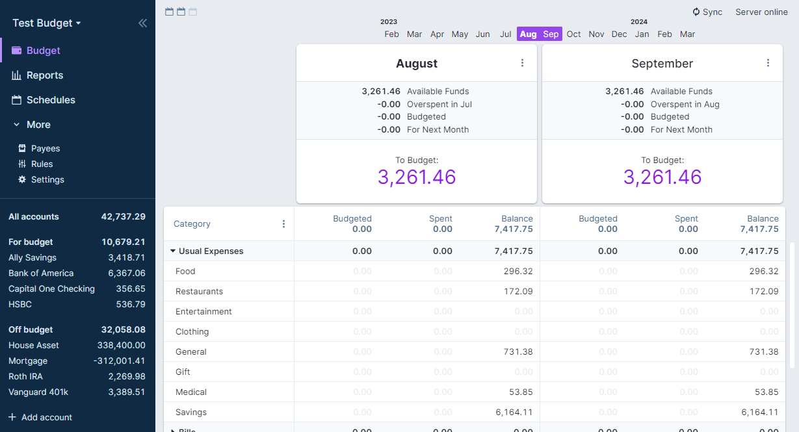

# Self-Hosting Weekly

## October 23, 2026 · Edition #9

This week leaned toward mature, dependable replacements for paid services: budgeting, expense splitting, e-signatures, scheduling, project management, collaborative writing, bookmarks, file transfer, translation, audiobooks, short links, design, surveys, passwords, and documentation.

> Archived from the original weekly ChatGPT report. The wording has been normalized for the Markdown archive while preserving the projects, recommendations, and week-specific context.

## Top picks

- **Actual Budget — strongest subscription replacement**
- **Gokapi — lightweight server utility**
- **Documenso — business signing**
- **Penpot — creative/developer tool**
- **listmonk 7 — most interesting release**

---

## New & Interesting

### 1. Actual Budget ★ Editor's Pick

[Project link](https://github.com/actualbudget/actual)

Actual Budget was a local-first envelope-budgeting application with recurring transactions, reports, imports, and optional self-hosted synchronization. It was MIT licensed, completely free, and had roughly 30K stars with a consistent monthly development cadence.

**Why it earned a spot:** It was one of the clearest mature replacements for a recurring YNAB-style subscription.

### 2. Spliit ★ Household Utility

[Project link](https://github.com/spliit-app/spliit)

Spliit provided open-source shared expense tracking for groups, households, and trips, with expense categories, recurring expenses, and automatic calculation of who owed whom.

**Why it earned a spot:** Expense splitting is simple enough that it should not require a commercial financial account.

### 3. Firefly III

[Project link](https://github.com/firefly-iii/firefly-iii)

Firefly III took a traditional account/transaction/reporting approach to personal finance rather than Actual's envelope model. It was mature and better suited to users who wanted to understand cash flow and account history.

**Why it earned a spot:** Actual and Firefly solved overlapping problems with different philosophies, making both worth knowing.

### 4. Documenso ★ Business Utility

[Project link](https://github.com/documenso/documenso)

Documenso provided open-source electronic signatures with document templates, signing workflows, and developer APIs. It had more than 15K stars and remained active through October.

**Why it earned a spot:** Electronic signatures are an attractive SaaS category to own when usage is intermittent.

### 5. Cal.com

[Project link](https://github.com/calcom/cal.com)

Cal.com's self-hostable scheduling platform provided booking pages, availability, event types, and external-calendar integrations. The deployment and licensing model was heavier than the smallest schedulers and deserved review before commercial use.

**Why it earned a spot:** Scheduling is a recurring business expense where self-hosting can make sense when customization matters.

### 6. Planka ★ Lightweight Project Management

[Project link](https://github.com/plankanban/planka)

Planka offered polished boards, lists, cards, and collaboration for teams wanting a Trello-like experience. It had a free Community edition and a commercial Pro edition.

**Why it earned a spot:** It was attractive when Plane or OpenProject felt like too much.

### 7. HedgeDoc ★ Collaboration Pick

[Project link](https://github.com/hedgedoc/hedgedoc)

HedgeDoc remained a focused realtime collaborative Markdown editor with split source/preview editing. It was especially useful for meeting notes, shared technical writing, and teams comfortable with Markdown.

**Why it earned a spot:** Sometimes a shared document editor is better than adopting an entire knowledge platform.

### 8. TriliumNext Notes ★ Knowledge Management

[Project link](https://github.com/TriliumNext/Notes)

TriliumNext was a hierarchical personal knowledge base with rich notes, attributes, scripting, navigation trees, and highly customizable organization. A new web-clipper release candidate arrived October 12.

**Why it earned a spot:** It served power users who wanted deeper structure and programmability than ordinary notes apps.

### 9. Linkwarden ★ Research Utility

[Project link](https://github.com/linkwarden/linkwarden)

Linkwarden combined bookmark management with long-term web preservation, collections, tags, search, and collaboration. It preserved copies of pages instead of trusting that original URLs would remain available.

**Why it earned a spot:** Preserving the content behind bookmarks is considerably more useful than just saving links.

### 10. Gokapi ★ Editor's Pick

[Project link](https://github.com/Forceu/Gokapi)

Gokapi was a lightweight Firefox Send-style service for uploading files and generating temporary links with expiry dates, download limits, and optional passwords. It supported local or S3-compatible storage and used a Go-based architecture.

**Why it earned a spot:** This was exactly the kind of utility that fits naturally on a Raspberry Pi or NAS behind an existing reverse proxy.

### 11. LibreTranslate ★ Developer Utility

[Project link](https://github.com/LibreTranslate/LibreTranslate)

LibreTranslate offered a self-hosted translation UI and API using locally installed language models. It could operate offline and keep text away from commercial translation services.

**Why it earned a spot:** A private translation API is useful as a building block for personal software and document workflows.

### 12. Audiobookshelf ★ Media Pick

[Project link](https://github.com/advplyr/audiobookshelf)

Audiobookshelf provided audiobook and podcast libraries with browser and mobile clients, per-user progress, metadata, cover art, permissions, and podcast discovery/download. It had a substantial community and official Docker images.

**Why it earned a spot:** It was one of the more polished self-hosted media applications with genuinely useful mobile support.

### 13. Shlink ★ Small Utility

[Project link](https://github.com/shlinkio/shlink)

Shlink created branded short links on a domain you controlled and added visit tracking, tagging, analytics, and APIs. It had a long development history and several database options.

**Why it earned a spot:** A personal short-link service is a useful small tool for websites and software projects without a Bitly subscription.

### 14. Penpot ★ Editor's Pick

[Project link](https://github.com/penpot/penpot)

Penpot provided collaborative interface design, prototypes, design systems, and developer-oriented workflows based on open web standards. It was one of the most credible Figma-style open-source design platforms.

**Why it earned a spot:** For software developers, design collaboration is a meaningful recurring SaaS category that can be self-hosted.

### 15. Excalidraw ★ Visual Utility

[Project link](https://github.com/excalidraw/excalidraw)

Excalidraw was a browser-based whiteboard and diagramming tool with a distinctive hand-drawn style. It excelled at architecture diagrams, process flows, and quick technical sketches.

**Why it earned a spot:** It provided just enough structure for software diagrams without becoming cumbersome.

### 16. LimeSurvey

[Project link](https://github.com/LimeSurvey/LimeSurvey)

LimeSurvey remained a mature survey platform with many question types, conditional logic, response collection, and reporting. It prioritized survey depth over the visual simplicity of newer form builders.

**Why it earned a spot:** It was still one of the better choices when survey logic mattered more than design polish.

### 17. Vaultwarden ★ Security Utility

[Project link](https://github.com/dani-garcia/vaultwarden)

Vaultwarden was a lightweight Rust server compatible with the Bitwarden client ecosystem. Existing desktop and mobile clients could point at the self-hosted server while the backend remained far lighter than Bitwarden's full official stack.

**Why it earned a spot:** It was one of the clearest examples of a small self-hosted service replacing a recurring subscription while retaining polished clients.

### 18. OpenProject

[Project link](https://github.com/opf/openproject)

OpenProject covered tasks, timelines, Gantt, agile boards, roadmaps, and collaboration for organizations needing formal project management. It was heavier than Planka but much more mature for serious long-running projects.

**Why it earned a spot:** It remained the heavyweight option when simple Kanban stopped being enough.

### 19. Organizr ★ Infrastructure Exception

[Project link](https://github.com/causefx/Organizr)

Organizr brought multiple self-hosted applications into one tabbed interface and navigation surface. It organized services rather than managing containers or monitoring resources.

**Why it earned a spot:** It earned an infra exception because it directly made the productivity apps in the stack easier to use.

### 20. Memos ★ Lightweight Notes

[Project link](https://github.com/usememos/memos)

Memos offered a chronological stream of short notes for ideas, work logs, links, and snippets, with a focused interface and lightweight deployment. The October 9 release candidate added editor suggestions, browsing improvements, and optional audio transcription.

**Why it earned a spot:** Fast capture can be more useful than an elaborate note hierarchy.

---

## Notable Updates

### 21. AppFlowy 0.14.10

[Project link](https://github.com/AppFlowy-IO/AppFlowy)

AppFlowy 0.14.10 added a database side-peek editor, improved navigation between records, and refined chart/list calculations. It built on an October 8 release that added conditional formatting and faster database loading.

**Why the update mattered:** These interaction details were the kind of polish that determines whether a database workspace feels good every day.

### 22. Paperless-ngx 3.3.3

[Project link](https://github.com/paperless-ngx/paperless-ngx)

Paperless-ngx shipped multiple October releases culminating in 3.3.3, including an October 16 security fix plus search, dashboard, suggestion, and subpath-hosting corrections.

**Why the update mattered:** Security fixes plus reverse-proxy/subpath improvements made the update especially relevant to self-hosted installations.

### 23. listmonk 7.0 Beta ★ Major Release

[Project link](https://github.com/knadh/listmonk)

listmonk 7 beta redesigned the administrative interface to be faster, more accessible, more mobile-friendly, and reportedly around 80% smaller in bundle size.

**Why the update mattered:** It was a substantial modernization of an already excellent Go/PostgreSQL newsletter platform.

### 24. Nextcloud 35.0.2

[Project link](https://github.com/nextcloud/server)

Nextcloud 35.0.2 fixed file sharing, permission handling, encryption metadata, default share expiry, and resharing behavior. The platform remained broad but operationally heavier than the small single-purpose tools favored elsewhere.

**Why the update mattered:** Correctness around permissions and encryption is foundational for a primary personal cloud.

### 25. Baserow 2.4.1

[Project link](https://github.com/bramw/baserow)

Baserow 2.4.1 improved workflow-history review and continued expanding the no-code database/application/automation platform. The open-source core remained MIT with paid functionality available separately.

**Why the update mattered:** It was increasingly useful as an application platform rather than merely an online spreadsheet.

### 26. BookLore 2.4.0 — Project Transition

[Project link](https://github.com/booklore-app/booklore)

BookLore announced that it was entering maintenance mode while active development moved to successor BookOrbit. Existing installs would continue receiving maintenance and security work, but the recommendation for new deployments changed.

**Why the update mattered:** Project continuity matters when software is expected to manage a personal library for years.

---

## Curation notes

This edition strongly favored applications over infrastructure. The recurring pattern was that mature self-hosted projects now exist in categories that used to feel SaaS-only: finance, design, signatures, support, analytics, and collaboration.