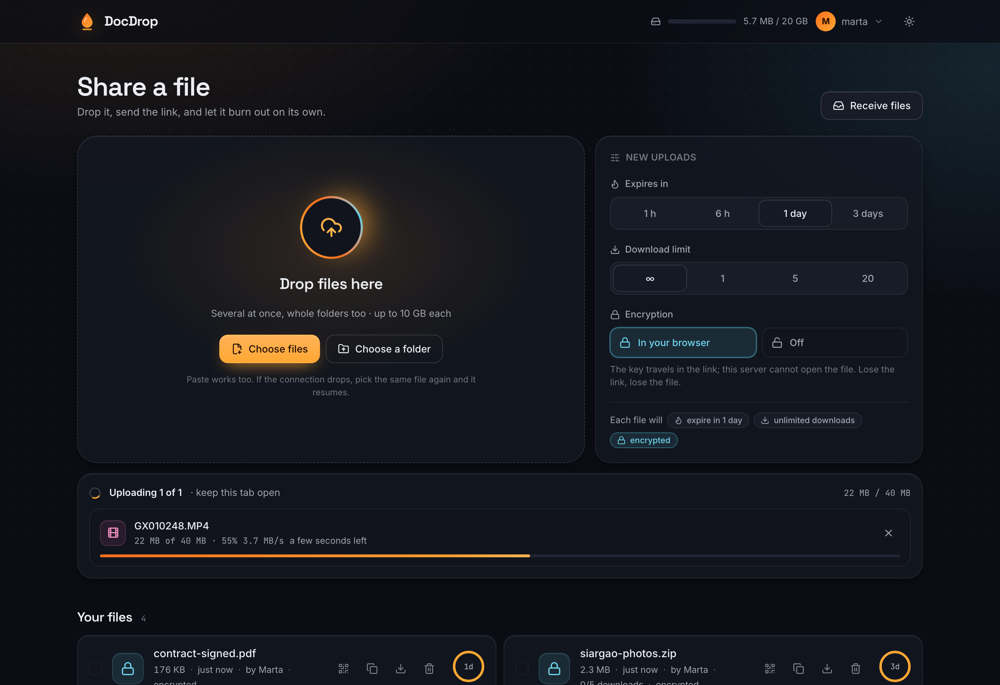

# Self-Hosting Weekly

## September 11, 2026 · Edition #3

This edition continued the productivity-first direction and turned up a strong set of scheduling, family organization, finance, file transfer, and project-management applications. The emphasis was on small software that could replace ordinary paid services rather than on homelab plumbing.

> Archived from the original weekly ChatGPT report. The wording has been normalized for the Markdown archive while preserving the projects, recommendations, and week-specific context.

## Top picks

- **Yuvomi — strongest household SaaS replacement**
- **DocDrop — focused file-transfer utility**
- **NexaNote — stylus-friendly private notes**
- **Calnode — lightweight scheduling architecture**
- **Brisk Budget — tiny finance stack**

---

## New & Interesting

### 1. Calnode ★ Editor's Pick

[Project link](https://github.com/Calnode/calnode)

Calnode packaged Calendly-style scheduling around a static Go binary and SQLite database. It supported Google, Microsoft 365, and CalDAV calendars, booking pages, teams, routing, webhooks, REST APIs, and optional video through LiveKit; AI booking was optional and could point at a local OpenAI-compatible endpoint.

**Why it earned a spot:** One binary plus SQLite for a capable scheduling service was an unusually attractive architecture, though the young project still needed cautious testing.

### 2. NexaNote

[Project link](https://github.com/TheZupZup/NexaNote)

NexaNote targeted a private Goodnotes/OneNote-style workflow with typed Markdown plus stylus drawing. A Flutter client paired with a small FastAPI backend, WebDAV sync, ARM64 Docker support, and ordinary `.md` files for typed notes.

**Why it earned a spot:** Stylus support is rare in self-hosted note software, and portable Markdown made the project especially interesting.

### 3. Lockpad

[Project link](https://github.com/Colbysdovi/Lockpad-Public)

Lockpad was a deliberately private notes app making zero outbound requests: no CDN fonts, telemetry, OAuth, or external APIs. It supported folders, tags, note linking, full-text search, and optional client-side encryption for sensitive notes.

**Why it earned a spot:** The 'works over your own private network and talks to nobody else' philosophy fit the newsletter's privacy goals well.

### 4. Brisk Budget ★ Tiny-App Pick

[Project link](https://briskbudget.app/)

Brisk Budget used Node's native HTTP server, vanilla JavaScript, JSON files, and only one external dependency. It still managed accounts, transactions, recurring items, transfers, net worth, forecasting, Sankey cash-flow diagrams, CSV imports, and backups.

**Why it earned a spot:** It was a refreshing example of useful personal finance software without a framework-heavy deployment stack.

### 5. Canutin

[Project link](https://github.com/fmaclen/canutin)

Canutin tracked accounts, assets, debts, transactions, investments, and multiple currencies with net-worth, balance-sheet, cash-flow, and portfolio views. Optional Plaid synchronization used the user's own credentials, while the underlying financial data stayed in SQLite and remained accessible through a REST API.

**Why it earned a spot:** SQLite, a good API, and investment tracking made it a compelling technically friendly finance option.

### 6. Yuvomi ★ Editor's Pick

[Project link](https://yuvomi.cloud/)

Yuvomi bundled 19 household modules covering tasks, calendars, budgeting, shared expenses, meals, recipes, shopping, and more. It integrated with Google, iCloud, and Nextcloud calendars, worked as a responsive PWA, reported around 1.5K stars, supported 24 languages, and shipped version 2.65.1 on September 8.

**Why it earned a spot:** It looked much further along than most new 'family OS' projects and could replace several separate subscriptions.

### 7. Waffled

[Project link](https://github.com/kevinpsites/waffled)

Waffled centered its household experience on an always-on kitchen iPad, with a native SwiftUI iPhone/iPad app and regular web interface sharing the same server. Modules included calendar, chores, rewards, goals, meal planning, recipes, groceries, pantry inventory, family photos, and recurring household rhythms.

**Why it earned a spot:** The dedicated iOS companion and kiosk-first UX made it more useful than a generic dashboard.

### 8. OpenFamily

[Project link](https://github.com/NexaFlowFrance/OpenFamily)

OpenFamily combined shopping lists, household tasks, appointments, weekly schedules, recipes, meal planning, and budgeting. It offered Android, PWA, and iCal/webcal support and had respectable early community traction.

**Why it earned a spot:** It addressed ordinary household organization rather than homelab administration.

### 9. Prism

[Project link](https://sandydargoport.github.io/prism/)

Prism aggregated existing services instead of becoming the system of record for everything. It connected Google and iCloud calendars, Microsoft To Do, OneDrive, Kroger-family grocery systems, and weather providers into a family-friendly display.

**Why it earned a spot:** A dashboard over existing systems can be more practical than migrating an entire household into a new platform.

### 10. Tribu

[Project link](https://github.com/search?q=Tribu+self-hosted+family&type=repositories)

Tribu combined household events, tasks, birthdays, shopping, meals, reminders, and rewards with a read-only shared-display mode for kitchen tablets. CalDAV and CardDAV compatibility let family data appear in native phone apps, with Home Assistant integration as an optional extra.

**Why it earned a spot:** Open standards and shared-display support made it more than another family dashboard.

### 11. Famlin

[Project link](https://famlin.app/)

Famlin was a private family social network for photos, milestones, trip journals, and polls in a calm chronological feed. It could link to an existing Immich installation or local photo directory rather than duplicating the photo library.

**Why it earned a spot:** Using Immich instead of competing with it was a smart design choice, although the project remained early-stage.

### 12. DocDrop ★ Utility Pick

[Project link](https://github.com/Ulzuhan/docdrop)

DocDrop was a focused WeTransfer alternative: resumable chunked uploads, folders, multiple files, automatic expiry, download limits, and browser-side end-to-end encryption. Its Go server embedded the React UI and used plain disk storage instead of a database.

**Why it earned a spot:** It solved one common problem cleanly and had an excellent lightweight architecture.

### 13. Relic

[Project link](https://github.com/ovidiuvio/relic)

Relic expanded the Pastebin concept to code, Markdown, images, archives, PDFs, spreadsheets, structured data, and Excalidraw diagrams. It added rich previews, expiry, passwords, spaces, tags, bookmarks, comments, forking, and diffs.

**Why it earned a spot:** It looked genuinely useful on a developer LAN rather than merely novel.

### 14. Orbit ★ Project-Management Pick

[Project link](https://github.com/noveum/orbit)

Orbit was a very new Linear/Jira-style project manager covering issues, boards, sprints, projects, documentation, standups, analytics, and realtime collaboration. The project explicitly promised no paid feature tiers under Apache-2.0, but self-hosting was still marked Preview.

**Why it earned a spot:** The polish was impressive for a brand-new project, though production use would have been premature.

### 15. Kanera

[Project link](https://github.com/happendev/Kanera)

Kanera sat between a small Kanban board and a heavyweight PM suite, with Kanban, tables, calendars, portfolio views, assigned work, completed work, structured fields, notes, automation, realtime collaboration, and a REST API.

**Why it earned a spot:** It offered useful cross-project visibility without trying to recreate every Jira feature.

### 16. Trackable

[Project link](https://trackable.cloud/)

Trackable was a self-hosted timekeeping app for freelancers and small teams with timers, manual entries, teams, manager/employee roles, shared calendars, vacation tracking, and PDF/CSV reports. Data lived in SQLite with weekly automatic backups.

**Why it earned a spot:** Time tracking is exactly the sort of per-user SaaS bill a focused self-hosted app can eliminate.

### 17. NexCal

[Project link](https://github.com/ribato22/nexcal)

NexCal approached booking from a service-business angle with multiple providers, Google Calendar sync, Google Meet consultations, payments, WhatsApp notifications, and administrative analytics. It deployed via Compose and was more specialized than single-person Calendly clones.

**Why it earned a spot:** Multi-provider scheduling is a materially different and useful niche.

### 18. Caldaver

[Project link](https://github.com/birdrock00/caldaver)

Caldaver put a modern Rust-based UI over CalDAV calendars, CardDAV contacts, and IMAP email. PostgreSQL stored preferences and cached metadata while the underlying personal data stayed in standards-based services.

**Why it earned a spot:** Good modern front ends for open protocols are rare, making this worth following.

### 19. mhabit

[Project link](https://github.com/FriesI23/mhabit)

mhabit, also known as Table Habit, was a local-first habit tracker written in Flutter for Android, iOS, Windows, macOS, and Linux. It kept data locally and could synchronize through any WebDAV endpoint.

**Why it earned a spot:** WebDAV made self-controlled synchronization possible without deploying a custom backend.

### 20. Expensave

[Project link](https://expensave.app/)

Expensave was a straightforward shared expense tracker for individuals and families. It handled income, expenses, recurring transactions, household calendars, and collaborative tracking without requiring a bank-aggregation SaaS.

**Why it earned a spot:** Its narrow scope made it more approachable than a full personal-finance platform.

### 21. Shortlink

[Project link](https://github.com/botnick/shortlink)

Shortlink was a feature-rich Bitly replacement designed around Cloudflare's free tier. It supported branded domains, custom/expiring/password-protected links, UTM generation, bot-filtered analytics, per-country/device routing, bulk CSV, and a QR-code studio.

**Why it earned a spot:** It was a perfect example of hosting something effectively for free instead of paying a recurring SaaS fee.

### 22. BillionMail

[Project link](https://github.com/Billionmail/BillionMail)

BillionMail combined a complete mail server with newsletter and email-marketing tooling, including lists, templates, delivery analytics, and campaign sending. It already had roughly 15K stars, putting it beyond the 'random weekend mail server' category.

**Why it earned a spot:** Email remains operationally serious, but the potential SaaS savings are substantial.

### 23. listmonk ★ Established but Still Excellent

[Project link](https://github.com/knadh/listmonk)

listmonk remained a focused Go + PostgreSQL mailing-list and newsletter platform with segmentation, templates, campaign analytics, and support for very large subscriber lists. It had crossed roughly 20K stars.

**Why it earned a spot:** It was one of the clearest examples of a mature open-source replacement for recurring newsletter SaaS.

---

## Notable Updates

### 24. AppFlowy — September Release

[Project link](https://github.com/AppFlowy-IO/AppFlowy)

AppFlowy had matured into a broad Notion-style workspace covering documents, databases, project views, wikis, and collaboration across desktop and mobile. Its September 1 release and roughly 76K stars made it a much more established option than most new workspace projects.

**Why the update mattered:** The project was increasingly becoming a mature choice rather than merely an 'open-source Notion clone.'

### 25. Glance 0.8.6

[Project link](https://github.com/glanceapp/glance)

Glance 0.8.6 arrived roughly a week earlier and the project remained extremely active at around 36K stars. It aggregated feeds, Reddit/Hacker News, YouTube, GitHub, weather, bookmarks, and service status into a fast information dashboard.

**Why the update mattered:** It remained the benchmark newer personal dashboards needed to beat.

### 26. Trilium 0.105.0

[Project link](https://github.com/TriliumNext/Notes)

Trilium's 0.105.0 line continued one of the longest-running serious self-hosted personal knowledge bases, with hierarchical notes, rich editing, powerful search, and extensive organization. Community traction remained strong.

**Why the update mattered:** Longevity matters when software is expected to hold years of personal knowledge.

---

## Curation notes

The strongest recurring theme was lightweight deployment: one binary, SQLite, plain files, and standards such as WebDAV or CalDAV showed up repeatedly.