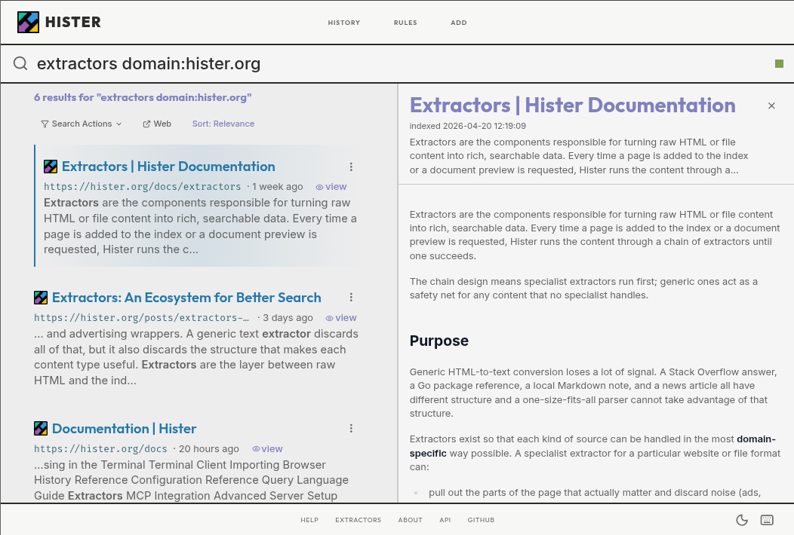

# Self-Hosting Weekly

## October 2, 2026 · Edition #6

This edition had a strong mix of small productivity tools, business SaaS replacements, and developer utilities. Hister was the standout discovery, while Kaneo, ArchiveBox, and Dagu represented the kind of focused, durable software the newsletter increasingly favored.

> Archived from the original weekly ChatGPT report. The wording has been normalized for the Markdown archive while preserving the projects, recommendations, and week-specific context.

## Top picks

- **Hister — private search/recall**
- **Pomodoist — cross-platform task/focus app**
- **Kaneo — lightweight Linear alternative**
- **ArchiveBox — durable web archive**
- **Dagu — small-server automation**

---

## New & Interesting

### 1. Hister ★ Editor's Pick

[Project link](https://github.com/asciimoo/hister)

Hister acted as a private search engine for things already encountered: a browser extension indexed the full text of visited pages, it could watch local folders and import history/bookmarks, and users could search through web UI, TUI, CLI, API, or MCP. It was a Go app that could run as one binary with SQLite and had climbed to roughly 5.8K stars.

**Why it earned a spot:** Automatic full-content recall solved a different and very real problem from ordinary bookmark management.

### 2. Pomodoist ★ Productivity Pick

[Project link](https://pomodoist.com/)

Pomodoist combined Todoist-style inbox/today/upcoming/projects/tags with Kanban, Eisenhower matrix, timeline planning, Pomodoro sessions, statistics, natural-language entry, and voice capture. It had macOS, Windows, Linux, web, iOS/iPadOS/watchOS, and Telegram clients, with Android arriving around the same period.

**Why it earned a spot:** Native clients are where self-hosted productivity projects often fail, so the cross-platform commitment was notable.

### 3. PHP Ledger ★ Great Idea, Major Caveat

[Project link](https://phpledger.com/)

PHP Ledger offered real small-business bookkeeping: double-entry journals, invoices, bills, inventory movements, bank reconciliation, P&L, balance sheet, and cash reporting, using PHP 8.2 plus MySQL/MariaDB. Version 1.4.7 shipped September 27, but the developer then announced maintenance had stopped for lack of funding.

**Why it earned a spot:** The architecture and accounting model were excellent, but the maintenance announcement made it a project to watch rather than deploy.

### 4. Invoicerr ★ One to Watch

[Project link](https://invoicerr.app/)

Invoicerr was a newer invoicing platform with quotes, invoices, payments, reconciliation, and country-aware electronic invoicing/tax-office integration. Its data-driven approach covered multiple European e-invoice regimes and it had already crossed roughly 700 stars.

**Why it earned a spot:** E-invoicing is increasingly where simplistic invoice generators stop being enough.

### 5. Kaneo ★ Lightweight Linear Pick

[Project link](https://github.com/usekaneo/kaneo)

Kaneo provided board, list, calendar, Gantt, backlog, dependencies, custom fields, comments, attachments, time tracking, and automation rules that could respond to GitHub/Gitea activity. It also exposed REST, webhooks, and MCP and used MIT licensing with no enterprise edition hiding features.

**Why it earned a spot:** It hit a useful middle ground: less than Plane, much more than Trello.

### 6. Overtchat

[Project link](https://github.com/search?q=Overtchat+self-hosted&type=repositories)

Overtchat was a deliberately stripped-down private AI chat interface with TTS/STT, search, native Android/iOS clients, no telemetry, and a roughly 1 GB Compose deployment. It intentionally avoided RAG/plugin/agent bloat.

**Why it earned a spot:** The interesting part was the family-friendly native client experience rather than another agent platform.

### 7. Daily Stars Explorer

[Project link](https://github.com/emanuelef/daily-stars-explorer)

Daily Stars Explorer analyzed a GitHub repository's full history of daily stars, commits, forks, PRs, issues, and contributors and correlated spikes with Hacker News, Reddit, and YouTube attention.

**Why it earned a spot:** It was useful for judging whether fast-growing open-source projects had real activity behind the stars.

### 8. Helix

[Project link](https://github.com/search?q=Helix+Subsonic+music+self-hosted&type=repositories)

Helix sat alongside Navidrome/Subsonic and added artist/song radio, discovery, configurable stations, shared listening, playlist imports, and acquisition/tagging workflows via slskd and Beets.

**Why it earned a spot:** It attacked the biggest weakness of owning music locally: discovery and friction getting new music into the library.

### 9. LibreDesk

[Project link](https://github.com/abhinavxd/libredesk)

LibreDesk was emerging as a credible Zendesk/Help Scout alternative with strong development activity and AGPL licensing rather than open-core feature gating.

**Why it earned a spot:** A help desk is a classic boring recurring business SaaS bill that self-hosting should be able to eliminate.

### 10. FreeScout ★ Lightweight Helpdesk Choice

[Project link](https://github.com/freescout-helpdesk/freescout)

FreeScout remained the lighter shared-mailbox/helpdesk option, running on PHP/Laravel even on shared hosting with unlimited agents, tickets, and mailboxes. Its core was AGPL while many extras were sold as one-time modules rather than subscriptions.

**Why it earned a spot:** That business model aligned unusually well with a preference for FOSS or one-time purchases.

### 11. Leantime

[Project link](https://github.com/Leantime/leantime)

Leantime combined tasks, Kanban, Gantt, tables, lists, calendars, milestones, sprints, timesheets, goals, wikis, retrospectives, and planning canvases. It explicitly designed for users with ADHD, dyslexia, and autism and could run on PHP/MySQL or Docker.

**Why it earned a spot:** It had a clearer philosophy than most all-in-one PM tools: serious project management for people who are not professional project managers.

### 12. Chatwoot

[Project link](https://github.com/chatwoot/chatwoot)

Chatwoot consolidated website chat, email, WhatsApp, Instagram, Facebook, Telegram, SMS, contacts, automations, reports, and help-center content into one support inbox. It was one of the healthiest large projects in the category, though open-core rather than completely FOSS.

**Why it earned a spot:** For true omnichannel support, its maturity gap over most newcomers was huge.

### 13. ArchiveBox ★ Keep-the-Web Pick

[Project link](https://github.com/ArchiveBox/ArchiveBox)

ArchiveBox saved pages as HTML, single-file HTML, screenshots, PDFs, WARC, and extracted article text, and could archive video with yt-dlp or clone Git repositories. Imports could come from bookmarks, browser history, RSS, Pocket, or Pinboard, with files plus a SQLite index underneath.

**Why it earned a spot:** Paired with Hister, it offered a powerful pattern: Hister remembers everything; ArchiveBox deliberately preserves what must not disappear.

### 14. AFFiNE

[Project link](https://github.com/toeverything/AFFiNE)

AFFiNE combined Notion-style documents/databases with a Miro-style edgeless whiteboard and local-first realtime synchronization. It supported desktop apps and Docker self-hosting, though the product model was open-core.

**Why it earned a spot:** Few tools genuinely merged document structure and spatial thinking this well.

### 15. Datasette ★ Developer Utility

[Project link](https://datasette.io/)

Datasette turned SQLite databases into searchable web interfaces and JSON APIs and increasingly supported custom mini-apps inside the same instance. September security releases also mattered for exposed deployments.

**Why it earned a spot:** Turning a SQLite file into a useful web app remained an underappreciated superpower.

### 16. PocketBase

[Project link](https://github.com/pocketbase/pocketbase)

PocketBase packaged SQLite, realtime subscriptions, authentication, file storage, admin UI, and REST-like APIs into one executable. It could also be embedded as a Go framework for custom routes and hooks.

**Why it earned a spot:** It was the backend equivalent of the lightweight architecture favored throughout these reports.

### 17. Dagu

[Project link](https://github.com/dagu-org/dagu)

Dagu wrapped shell commands, scripts, SSH tasks, Docker jobs, and other processes into scheduled dependency graphs with retries, history, and a web UI. It stayed single-binary with no external database or message broker.

**Why it earned a spot:** It was automation infrastructure, but directly simplified everyday self-hosted jobs rather than becoming another platform to babysit.

### 18. Helical Insight

[Project link](https://www.helicalinsight.com/)

Helical Insight crossed 1,000 GitHub stars after bringing previously enterprise-oriented features such as SSO, embedded analytics, multi-tenancy, row-level security, white-labeling, report bursting, and pixel-perfect reports into its Community Edition.

**Why it earned a spot:** Removing the usual enterprise feature gates made it much more relevant for real self-hosting.

### 19. OpenWork

[Project link](https://github.com/different-ai/openwork)

OpenWork was a macOS/Windows/Linux desktop agent workspace built on OpenCode, able to read, edit, and create files in a workspace with skills and MCP servers. It supported API-key providers, ChatGPT sign-in, and local Ollama/OpenAI-compatible models.

**Why it earned a spot:** It was more directly useful than most agent noise because it aligned with established coding-tool workflows.

### 20. CliRelay

[Project link](https://github.com/search?q=CliRelay+AI+gateway&type=repositories)

CliRelay exposed one OpenAI/Claude/Gemini/Codex-compatible endpoint for coding tools with multi-tenant console, request logs, and spend quotas. It was MIT licensed, written in Go, and had reached around 1K stars.

**Why it earned a spot:** For multi-provider coding workflows, centralizing credentials and routing locally was practical infrastructure.

### 21. Overtchat's native-client lesson

[Project link](https://github.com/search?q=Overtchat+self-hosted&type=repositories)

Overtchat deserved a second brief callout because it shipped native Android and iOS clients from the start. Community reaction highlighted the same lesson repeatedly: a technically excellent self-hosted service that nobody wants to use on a phone is not a real replacement.

**Why it earned a spot:** Native client quality should be treated as a core product feature, not an afterthought.

---

## Notable Updates

### 22. ProjectSend 2.6.0

[Project link](https://www.projectsend.org/)

ProjectSend moved quickly from the 2.4.x line to 2.6.0 while keeping Docker as the recommended deployment and modernizing the long-running client-file portal.

**Why the update mattered:** The major rewrite was moving fast enough to justify a repeat.

### 23. Kaneo 2.29.2

[Project link](https://github.com/usekaneo/kaneo)

Kaneo reached 2.29.2 by September 29, with repository automation, REST, webhooks, and MCP making it increasingly attractive for small software projects.

**Why the update mattered:** It was rapidly becoming one of the strongest 'less than Plane, more than Trello' options.

### 24. Plane 1.4.2

[Project link](https://github.com/makeplane/plane)

Plane reached 1.4.2 with issues, cycles, modules, views, pages, analytics, and an open-source MCP server. Its Community Edition was AGPL while paid capabilities remained in a separate commercial edition.

**Why the update mattered:** It remained the mature choice when Kaneo's smaller scope became limiting.

### 25. Chatwoot 4.18.0

[Project link](https://github.com/chatwoot/chatwoot)

Chatwoot reached 4.18.0 with strong ongoing activity and continued to rank near the top of current self-hosted support-tool comparisons.

**Why the update mattered:** Ecosystem health matters heavily in customer-support software.

### 26. Datasette security releases

[Project link](https://datasette.io/)

Users were advised to be on at least 0.65.5 stable or 1.0a40 alpha after a table-permissions bypass and related September security work.

**Why the update mattered:** Internet-exposed data tools should not postpone authorization/security fixes.

### 27. PHP Ledger 1.4.7 — maintenance stops

[Project link](https://github.com/phpLedger/phpLedger)

Version 1.4.7 arrived September 27 together with the announcement that development and maintenance had stopped because funding could not be secured.

**Why the update mattered:** Accounting software inevitably faces security, runtime, and regulatory change, so this materially changed the recommendation.

---

## Curation notes

The clearest lesson was that project health matters as much as feature lists. PHP Ledger was architecturally appealing, but an explicit maintenance stop turned it into a cautionary example overnight.