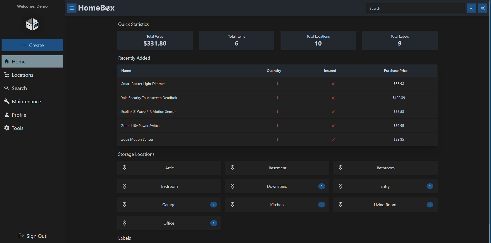

# Self-Hosting Weekly

## October 16, 2026 · Edition #8

This edition emphasized small applications that solved practical personal problems: document management, inventory, notes, learning, subscriptions, vehicles, file transfer, feedback, investing, travel, and habit tracking. Several genuinely new projects appeared, but maturity was called out explicitly rather than treating a seven-star repo like a proven service.

> Archived from the original weekly ChatGPT report. The wording has been normalized for the Markdown archive while preserving the projects, recommendations, and week-specific context.

## Top picks

- **Suchi — lightweight document management**
- **HomeBox — mature household inventory**
- **Wallos — subscription tracker**
- **PairDrop — cross-platform file transfer**
- **Wiki.js 3.0 — major upcoming release**

---

## New & Interesting

### 1. Suchi ★ Editor's Pick

[Project link](https://github.com/johnnybravo-xyz/suchi)

Suchi was a new document-management system inspired by Johnny.Decimal that deliberately simplified the usual Paperless-style metadata model. Documents could arrive through uploads, watched folders, email, or mobile, while OCR made them searchable; the architecture was one Go binary, SQLite, and content-addressed file storage.

**Why it earned a spot:** The developer had clearly identified a usability problem in existing document systems and solved it with a simpler architecture.

### 2. OpenInvento ★ New Project

[Project link](https://github.com/openinvento/openinvento)

OpenInvento reached version 1.0 on October 13 after multiple betas and hundreds of commits. It tracked household possessions and storage locations and supported Docker/Compose deployment.

**Why it earned a spot:** It was a practical household utility, especially for workshops, electronics, tools, and collections, though still a very small project.

### 3. Catch ★ Google Keep Alternative

[Project link](https://github.com/iiloni/catch)

Catch focused on the simplicity of Google Keep with rich-text notes, checklists, colors, nested tags, attachments, recurring reminders, a Kanban-style attention board, offline-first sync, Android, and Google Keep import. The project was very young and primarily AI-assisted.

**Why it earned a spot:** There are countless Notion clones and surprisingly few good self-hosted 'capture a thought in three seconds' apps.

### 4. Engram ★ Learning Utility

[Project link](https://github.com/bestnite/engram)

Engram used FSRS v6 spaced repetition and supported cloze deletions, typed answers, multiple choice, math, shared decks, and per-user schedules. Its Svelte PWA and Go backend could use SQLite or PostgreSQL and reportedly idled below 30 MB.

**Why it earned a spot:** A lightweight multiuser learning server could be genuinely useful in a household without separate cloud accounts.

### 5. DailyHub

[Project link](https://github.com/baselhusam/daily-hub)

DailyHub combined projects, tasks, milestones, habits, and daily planning into one personal dashboard. It used Next.js plus SQLite and offered AMD64/ARM64 containers, but had no built-in authentication at the time.

**Why it earned a spot:** A personal command center was attractive, but lack of auth made LAN-only or reverse-proxy protection essential.

### 6. Matinee

[Project link](https://github.com/ivegonetoplaid/matinee)

Matinee recommended movies by mood and richer experiential metadata rather than only genre. It offered a demo and Docker Compose deployment but required a TMDB API token and remained early-stage.

**Why it earned a spot:** Media discovery is still one of the places where self-hosted libraries often lag commercial platforms.

### 7. VesperTape ★ Small Utility

[Project link](https://github.com/KhawarMehfooz/VesperTape)

VesperTape wrapped yt-dlp in a retro web interface for queued video, audio, and playlist downloads. Docker deployment made it suitable for a small server with mounted media storage.

**Why it earned a spot:** A simple single-purpose web utility can be more useful than memorizing command-line switches, assuming the content is authorized for download.

### 8. HomeBox ★ Editor's Pick

[Project link](https://github.com/sysadminsmedia/homebox)

HomeBox was the mature household inventory choice, tracking possessions, locations, categories, custom fields, purchase prices, warranties, documents, photos, and maintenance. It used Go + SQLite, embedded its UI, and reported very low idle memory usage.

**Why it earned a spot:** This was something worth installing permanently for tools, electronics, equipment, and household purchases.

### 9. Wallos ★ Editor's Pick

[Project link](https://github.com/ellite/Wallos)

Wallos tracked subscriptions, renewals, payment information, categories, budgets, multiple currencies, statistics, notifications, OIDC, and API access. It had roughly 8.7K stars and a focused PHP/Docker architecture.

**Why it earned a spot:** A self-hosted app whose purpose is helping you cancel other subscriptions is wonderfully on-theme.

### 10. LubeLogger

[Project link](https://github.com/hargata/lubelog)

LubeLogger tracked vehicle maintenance, repairs, fuel, mileage, and ownership expenses. It had enough history and Docker support to be a sensible starting point for long-term vehicle records.

**Why it earned a spot:** Vehicle service history is important personal data that does not need to live in a commercial cloud.

### 11. PairDrop ★ Utility Pick

[Project link](https://github.com/schlagmichdoch/PairDrop)

PairDrop brought AirDrop-style browser-to-browser transfers to mixed operating systems without accounts or special client installs. It supported self-hosting and direct peer-to-peer transfer where possible.

**Why it earned a spot:** A permanently available cross-platform file-transfer page is one of the easiest small utilities to justify.

### 12. Zipline

[Project link](https://github.com/diced/zipline)

Zipline was a self-hosted upload server for screenshots, files, and short links with a web UI and ShareX-style integrations. Unlike PairDrop, it retained uploads for later access.

**Why it earned a spot:** It fit naturally behind a personal reverse proxy as a private screenshot and file-sharing endpoint.

### 13. CryptPad

[Project link](https://github.com/cryptpad/cryptpad)

CryptPad offered collaborative documents, spreadsheets, forms, presentations, and other tools built around end-to-end encryption. Organizations could host the server while keeping document content inaccessible to the server itself.

**Why it earned a spot:** It was a strong choice when privacy and data ownership mattered as much as eliminating subscription fees.

### 14. Fider ★ Developer SaaS Replacement

[Project link](https://github.com/getfider/fider)

Fider provided a public feedback portal where users could submit ideas, vote, and follow product improvements. It replaced scattered email and support-ticket feature requests with a dedicated customer-facing board.

**Why it earned a spot:** For open-source projects gaining users, this could replace Canny or UserVoice without another subscription.

### 15. Reactive Resume

[Project link](https://github.com/AmruthPillai/Reactive-Resume)

Reactive Resume was a privacy-conscious open-source resume builder with configurable layouts and document export. It could be self-hosted for individuals or organizations.

**Why it earned a spot:** Resume builders are a classic example of charging recurring fees for something people need only occasionally.

### 16. Ghostfolio

[Project link](https://github.com/ghostfolio/ghostfolio)

Ghostfolio tracked investment portfolios across accounts, including stocks, ETFs, and crypto, with performance, allocation, dividends, imports, and diversification analysis. It used Angular/NestJS with PostgreSQL and Redis and had ARM64 Docker images.

**Why it earned a spot:** It was one of the more credible self-hosted investment-tracking applications.

### 17. Dawarich

[Project link](https://github.com/Freika/dawarich)

Dawarich collected and visualized personal location history, previous trips, and visited places as a self-hosted alternative to cloud location timelines. It was more resource-intensive than tiny SQLite utilities but offered distinctive functionality.

**Why it earned a spot:** Location history is deeply personal data, making local ownership especially valuable.

### 18. AdventureLog

[Project link](https://github.com/seanmorley15/AdventureLog)

AdventureLog combined trip planning with a personal record of places visited and travel experiences. It emphasized building a long-term self-hosted travel archive.

**Why it earned a spot:** Travel journals are exactly the kind of personal history users may want to preserve for decades.

### 19. Wakapi ★ Developer Pick

[Project link](https://github.com/muety/wakapi)

Wakapi was a lightweight self-hosted backend compatible with the WakaTime ecosystem, collecting coding-time statistics, languages, projects, and development habits through existing editor integrations.

**Why it earned a spot:** It let developers quantify their coding activity without sending it to a commercial analytics service.

### 20. changedetection.io ★ Practical Utility

[Project link](https://github.com/dgtlmoon/changedetection.io)

changedetection.io watched pages for changes in prices, availability, documentation, announcements, and other content, with alerting and optional browser automation for dynamic pages.

**Why it earned a spot:** It was an immediately useful replacement for Visualping/Distill-style hosted monitoring.

### 21. Karakeep

[Project link](https://github.com/karakeep-app/karakeep)

Karakeep combined bookmarks, notes, images, full-text search, and optional automatic tagging into a searchable personal archive. AI features were optional rather than the core value.

**Why it earned a spot:** It remained a more established choice for people who wanted to collect almost everything they encountered online.

### 22. Diurnal

[Project link](https://github.com/zodac/diurnal)

Diurnal was a focused habit tracker with calendars, streaks, averages, trends, daily notes, OIDC, and mobile-friendly design. It used PostgreSQL and Docker Compose rather than SQLite.

**Why it earned a spot:** A small private habit tracker can be more appropriate than a full productivity platform.

---

## Notable Updates

### 23. Wiki.js 3.0 Beta 672

[Project link](https://github.com/requarks/wiki)

Wiki.js 3 beta 672 shipped October 16 with inline math, improved search, page colors, personal access tokens, navigation customization, unsaved-edit recovery, editor improvements, and Git-sync fixes. The developer still explicitly warned against production use.

**Why the update mattered:** The 3.x line was clearly a substantial modernization, but the production warning mattered.

### 24. Komga 1.29.1

[Project link](https://github.com/gotson/komga)

Komga 1.29.0 and 1.29.1 improved the new NextUI interface, added OAuth2 login, let admins make NextUI default, expanded comic metadata, and moved sessions into the database for more reliable Docker restarts.

**Why the update mattered:** The UI is often what determines whether family members actually use a self-hosted media server.

### 25. Syncthing 2.1.6 Stable

[Project link](https://github.com/syncthing/syncthing)

Syncthing 2.1 added grouped devices/folders, HTTP/HTTPS proxy support, options to reduce database overhead, and configurable web-session duration. 2.1.6 remained stable while 2.1.7 RC carried additional fixes.

**Why the update mattered:** It continued to be one of the strongest cloud-free folder synchronization tools.

### 26. FreshRSS 1.30.1 Security Update

[Project link](https://github.com/FreshRSS/FreshRSS)

FreshRSS 1.30.1 was a security-focused maintenance release with multiple patches and bug fixes. The project remained a mature RSS reader with a large extension ecosystem.

**Why the update mattered:** Feed readers process untrusted web content constantly, so timely security maintenance matters.

### 27. Stirling PDF 3.1.0 ★ Major Feature Release

[Project link](https://github.com/Stirling-Tools/Stirling-PDF)

Stirling PDF 3.1.0 redesigned document signing, enabled group signing by default for new users, added a beta office-conversion engine, and improved table/OCR text editing and attachments. The project had roughly 94K stars.

**Why the update mattered:** Stirling was evolving from a PDF utility collection into a broader document-processing platform.

---

## Curation notes

The strongest pattern was focused apps with small footprints. The report also started explicitly treating AI-assisted development as a reason to inspect tests, architecture, and security more carefully rather than as an automatic positive or negative.